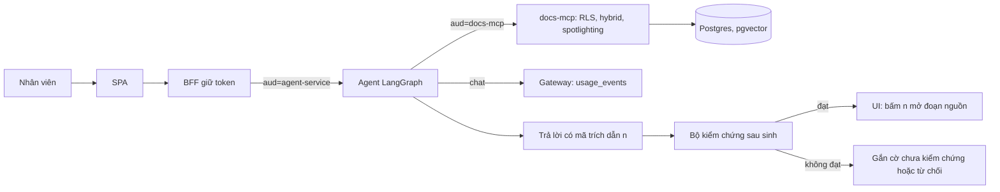

# Giải pháp: trợ lý AI nội bộ có trích dẫn kiểm chứng được và hành động qua MCP

Phạm vi: [ADR-006](adr/ADR-006-scope-rag-citations.md), sửa bởi [ADR-007](adr/ADR-007-actions-cache-observability.md). Lộ trình: [`ROADMAP.md`](ROADMAP.md). Hợp đồng dùng chung và quy tắc code: [`design/contracts.md`](design/contracts.md).

## 1. Bài toán

Nhân viên cần tra cứu quy định và tài liệu của công ty. Hệ thống phải:

1. **Dẫn nguồn kiểm chứng được.** Mỗi câu trả lời gắn mã `[n]` trỏ tới một đoạn cụ thể (văn bản, Điều, khoản, vị trí ký tự). Không đủ nguồn thì từ chối, không bịa.
2. **Không lộ tài liệu người dùng không được xem.** Phân quyền thực thi ở cơ sở dữ liệu, không dựa vào prompt. Tài liệu độc (prompt injection gián tiếp) không được điều khiển agent.
3. **Làm được việc qua MCP một cách an toàn.** Tạo và xử lý ticket, gửi báo cáo vào nhóm chat. Quyền theo vai trò thực thi ở server; thao tác ghi hoặc gửi ra ngoài phải được người dùng duyệt.

## 2. Câu hỏi nghiên cứu

| RQ | Câu hỏi | Chỉ số | Milestone |
|---|---|---|---|
| RQ1 Truy xuất | Hybrid (vector và từ khoá) cùng rerank cải thiện recall@k bao nhiêu trên tài liệu tiếng Việt so với chỉ vector hoặc chỉ BM25? | recall@5/@10, MRR, nDCG; 4 cấu hình | R1 |
| RQ2 Trích dẫn | Bước kiểm chứng sau sinh nâng citation precision và faithfulness bao nhiêu, đổi lại chi phí và độ trễ bao nhiêu? | citation precision/recall, faithfulness, tỉ lệ từ chối đúng, chi phí/câu, độ trễ p50/p95 | R2 |
| RQ3 An toàn | Với ACL ở tầng DB và spotlighting, tỉ lệ rò tài liệu trái quyền và tỉ lệ tấn công thành công của tài liệu độc là bao nhiêu, kể cả khi tấn công nhằm tạo ticket hoặc gửi dữ liệu mật vào nhóm chat? | leak rate (đích 0), ASR theo kỹ thuật injection, có và không từng lớp phòng thủ | R3 |
| RQ4 Cache | Cache tiết kiệm bao nhiêu chi phí và độ trễ, có làm giảm chất lượng hay rò dữ liệu giữa các phạm vi quyền không? | hit rate, chi phí, độ trễ, chất lượng, số lần rò | Q1 |

Chưa có số đo nào cho RQ1 đến RQ4; các bảng kết quả là sản phẩm của R1 đến R3 và Q1.

## 3. Kiến trúc hiện tại

| Thành phần | Vai trò |
|---|---|
| Keycloak | IdP, OIDC, token exchange (RFC 8693) theo từng audience ([ADR-005](adr/ADR-005-token-flow.md)) |
| BFF (FastAPI) và SPA (React, TS) | Đăng nhập OIDC code với PKCE, giữ phiên ở Redis. Token chỉ ở BFF; trình duyệt chỉ có cookie `HttpOnly` và header CSRF ([ADR-002](adr/ADR-002-ui-react-bff.md)) |
| Gateway | Xác thực khoá API, proxy `/v1/chat/completions` tới provider, ghi `usage_events` và chi phí. Giữ khoá provider duy nhất. Không có PII, guard, router, breaker hay cache |
| Agent (LangGraph) | Router `docs`, `tickets` hoặc trả lời trực tiếp; checkpoint mã hoá ([ADR-004](adr/ADR-004-checkpoint-encryption.md)); gọi MCP bằng token đã exchange |
| docs-mcp | Truy xuất tài liệu có phân quyền (mục 3.1) |
| tickets-mcp và approval-signer (profile `tickets`) | Đọc ticket và đóng ticket qua luồng phê duyệt ký số ([`design/approval.md`](design/approval.md)) |
| Postgres và pgvector | Tài liệu, chunk, vector, RLS, usage, audit. Hạ tầng cố định, không bọc |
| Redis (`redis-state`) | Phiên BFF, taint, intent. Hạ tầng cố định, không bọc. Gateway không dùng Redis |
| mock-provider | Provider giả tất định cho test và E2E |
| Prometheus và Grafana (profile `obs`) | Metric và dashboard |

Chưa làm: `notify-mcp` (profile `notify`, A1), tạo ticket (A1), cache (Q1), trace OpenTelemetry (Q1). Compose mặc định gồm postgres, redis-state, keycloak, gateway, mock-provider, docs-mcp, agent, bff.

### 3.1 docs-mcp

Tool `search_documents(query, top_k, department_filter?)`, scope `docs:read`.

- **Phân quyền** ở SQL và RLS theo claims của token (phòng ban, cấp mật, vai trò), không theo tham số do LLM đưa. `department_filter` chỉ thu hẹp, không mở rộng quyền.
- **Spotlighting.** Kết quả bọc delimiter, mỗi đoạn có `source` và đánh dấu không đáng tin; mô tả tool nói rõ nội dung là dữ liệu tham khảo, không phải chỉ dẫn.
- **Taint.** Khi trả tài liệu có cấp mật, ghi taint theo thread vào Redis để bước ghi sau đó cảnh báo nguy cơ hạ cấp mật.
- **Truy xuất.** `pgvector_hybrid`: vector trộn full-text Postgres bằng RRF; rerank là tuỳ chọn (hiện adapter `none`). Embedder đang có `fake_hash` và `gateway_http`.
- **Còn lại ở R1.** Loader `vbpl_articles` (một Điều là một đơn vị), cột `article`, `clause`, `char_start`, `char_end`, embedder thật qua gateway, số chiều embedding theo model chọn (hiện cứng `vector(1024)`). Chi tiết: [`design/rag-citations.md`](design/rag-citations.md).

### 3.2 Luồng một câu hỏi

1. Router phân loại; nhánh `docs` gọi `search_documents` với token đã exchange.
2. docs-mcp lọc theo quyền trong SQL, trả các đoạn đã spotlighting kèm vị trí trích dẫn.
3. Agent sinh câu trả lời, mỗi câu có `[n]`; chỉ được trích đoạn đã truy xuất.
4. Bộ kiểm chứng (LLM-judge, đầu ra JSON) kiểm từng câu có được đoạn trích hỗ trợ; câu không được hỗ trợ bị gắn cờ hoặc bỏ.
5. UI hiển thị `[n]`; bấm mở đoạn nguồn và tô đúng câu được trích.

Đã chạy: bước 1 và 2 (với embedder giả). Bước 3 đến 5 thuộc R2.

## 4. Dữ liệu

Nguồn, giấy phép, checksum: [`data/SOURCES.md`](../data/SOURCES.md).

| Dữ liệu | Nội dung | Vai trò |
|---|---|---|
| Corpus luật | 19 luật và bộ luật Việt Nam từ vbpl.vn, 1.557 Điều, khoảng 1,82 triệu ký tự; văn bản quy phạm pháp luật không thuộc đối tượng bảo hộ quyền tác giả | Corpus chính cho RQ1, RQ2. Đơn vị trích dẫn là Điều (và khoản) |
| Ánh xạ ACL | Gán tất định theo nhóm chủ đề, giả lập: `hr` thành `HR` (c1), `it` thành `IT` (c1), `finance` và `legal` thành `ALL` (c0) | Tạo ranh giới quyền trên dữ liệu vốn công khai |
| Tài liệu mật ACME | 30 tài liệu tổng hợp (c2, c3) có canary, do `data/generator` sinh | Đo rò rỉ trái quyền |
| Corpus độc | `data/corpus/`, chưa xây (R3); 8 kỹ thuật injection | Đo ASR |
| Bộ câu hỏi | Chưa xây (R1); khoảng 150 câu, LLM sinh nháp từ từng Điều, người kiểm 100% nhãn; nhãn vàng là (văn bản, Điều, khoản) | RQ1, RQ2 |
| Zalo AI Legal Retrieval | 61.425 Điều, 3.298 câu hỏi có nhãn; chỉ 27 cặp nhãn rơi vào corpus đã chọn | Chỉ làm benchmark truy xuất ngoài |

UTS_VLC bị loại làm corpus vì nửa số dòng có số hiệu đầu văn bản không khớp thân văn bản (`data/SOURCES.md` §2).

## 5. Mô hình bảo mật

| Cơ chế | Nội dung |
|---|---|
| Danh tính xuyên suốt | Token chỉ ở BFF; mỗi hop lấy token riêng theo audience, không chuyển tiếp nguyên token |
| Phân quyền ở server | RLS và ACL trong SQL theo claims. LLM bị injection cũng chỉ làm được điều người dùng vốn được phép |
| Spotlighting và taint | Nội dung truy xuất luôn gắn nhãn không đáng tin; taint theo thread |
| Phê duyệt ký số | Thao tác ghi cần intent do MCP ký và approval do signer ký sau khi người dùng xem thẻ ([`design/approval.md`](design/approval.md)) |
| Audit | Bảng append-only, chuỗi hash HMAC với khoá ngoài DB; không lưu plaintext prompt |
| Giả định đe doạ | Agent có thể bị lừa nên quyền không đặt ở prompt. Không chống kẻ nắm cả quyền DBA lẫn khoá HMAC |

Phần lọc PII và guard prompt injection bằng mô hình (policy-sidecar) đã bị xoá khỏi đề tài; ảnh hưởng của từng lớp còn lại được đo trong ablation R4.

## 6. Đánh giá

| Nhóm | Chỉ số | RQ |
|---|---|---|
| Truy xuất | recall@k, MRR, nDCG theo loại câu | RQ1 |
| Trích dẫn | citation precision và recall (khung ALCE) | RQ2 |
| Câu trả lời | faithfulness; tỉ lệ từ chối đúng với câu không có đáp án | RQ2 |
| An toàn | leak rate (mỗi user trong 16 user hỏi bộ câu chạm tài liệu trái quyền; kiểm câu trả lời, trích dẫn, cache, log); ASR theo kỹ thuật injection | RQ3 |
| Hành động | chọn đúng tool và tham số, từ chối đúng khi thiếu quyền, không hành động khi chỉ hỏi | RQ3 |
| Chi phí, độ trễ | chi phí/câu từ `usage_events`, độ trễ p50/p95 | RQ2, RQ4 |

Phương pháp: judge hiệu chuẩn bằng 30 đến 50 câu chấm tay, báo Cohen's κ; judge khác họ với agent; báo cáo kèm khoảng tin cậy; công bố seed, prompt, phiên bản; mọi số liệu chạy lại được bằng script trong repo. Ablation ở R4 chạy với ít nhất hai model thật trong ngân sách cố định.

## 7. Tài nguyên

Mục tiêu: compose mặc định dưới 2,5 GB RAM lúc rảnh trên VPS 2 đến 4 vCPU, 4 GB RAM. Chưa đo cho stack hiện tại; R0 đo và ghi bảng vào README. Bật `tickets`, `notify`, `obs` sẽ vượt mức này, A1 và Q1 phải đo thật. Embedding gọi qua gateway tới API provider, không chạy model nặng tại chỗ.

## 8. Ngoài phạm vi

Đã xoá: analytics-mcp, policy-sidecar (guard, NER), benchmark gateway, spikes, `redis-cache` (thêm lại cùng cache ở Q1). Bản cũ ở git tag `backup/pre-prune-20261101`. Bỏ: gateway đầy đủ (rate limit, budget, fallback nhiều provider, router chi phí), trang admin, i18n, HA, mTLS, Helm, secret manager.

## 9. Tài liệu

| Tài liệu | Nội dung |
|---|---|
| [`design/contracts.md`](design/contracts.md) | Service, cổng, luồng token, scope, lỗi, schema DB, tool MCP, quy tắc Ports & Adapters |
| [`design/approval.md`](design/approval.md) | Luồng phê duyệt thao tác ghi |
| [`design/rag-citations.md`](design/rag-citations.md) | Thiết kế RAG và trích dẫn kiểm chứng được |
| [`adr/`](adr/) | Quyết định kiến trúc (ADR-002 đến ADR-007) |
| [`research/`](research/) | Xác minh M0, khảo sát GitHub |
| [`../data/SOURCES.md`](../data/SOURCES.md) | Nguồn dữ liệu, giấy phép, checksum |
