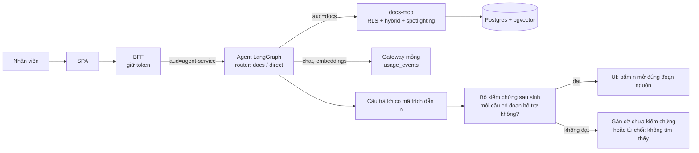

# Giải pháp: Trợ lý tri thức nội bộ có trích dẫn kiểm chứng được

> Phiên bản 2.0, 2026-10-30. Phạm vi theo [ADR-006](adr/ADR-006-scope-rag-citations.md), lộ trình ở [`ROADMAP.md`](ROADMAP.md) v2.0.
> Bản v1.3 (gateway đầy đủ, ticket/phê duyệt ký số, analytics, policy-sidecar, quan sát, hardening) xem lịch sử git; các phần đó nay đóng băng (mục 8).
> Hợp đồng dùng chung và quy tắc Ports & Adapters: [`design/00-contracts.md`](design/00-contracts.md) (§9 là nguồn chân lý). Quyết định D0–D15: [`design/DECISIONS-v1.2.md`](design/DECISIONS-v1.2.md).

## 1. Bài toán

Nhân viên cần tra cứu quy định và tài liệu của công ty. Hệ thống phải thoả hai yêu cầu:

1. **Mọi câu trả lời dẫn nguồn kiểm chứng được:** mỗi câu gắn mã `[n]` trỏ tới một đoạn cụ thể (văn bản, Điều, khoản, vị trí ký tự) mà người dùng mở ra đối chiếu. Không đủ nguồn thì từ chối, không bịa.
2. **Không bao giờ lộ tài liệu người dùng không được xem:** phân quyền thực thi ở tầng cơ sở dữ liệu, không dựa vào prompt. Tài liệu độc (prompt injection gián tiếp) không được điều khiển agent.

## 2. Câu hỏi nghiên cứu

| RQ | Câu hỏi | Chỉ số chính | Milestone |
|---|---|---|---|
| RQ1 Truy xuất | Hybrid (vector + từ khoá) và rerank cải thiện recall@k bao nhiêu trên tài liệu tiếng Việt so với chỉ vector hoặc chỉ BM25? | recall@5/@10, MRR, nDCG theo loại câu; so 4 cấu hình (vector, BM25, hybrid, hybrid+rerank) | R1 |
| RQ2 Trích dẫn | Bước kiểm chứng sau sinh (mỗi câu ↔ đoạn nguồn) nâng citation precision và faithfulness bao nhiêu, đổi lại chi phí và độ trễ bao nhiêu? | citation precision/recall, faithfulness, tỉ lệ từ chối đúng; chi phí/câu, độ trễ p50/p95; có và không có bộ kiểm chứng | R2 |
| RQ3 An toàn | Với ACL ở tầng DB (RLS) và spotlighting, tỉ lệ rò tài liệu trái quyền và tỉ lệ tấn công thành công của tài liệu độc là bao nhiêu? | leak rate (đích: 0), ASR theo kỹ thuật injection, có/không từng lớp phòng thủ | R3 |

Chưa có số đo nào cho RQ1–RQ3 tại thời điểm viết; các bảng kết quả là sản phẩm của R1–R3.

## 3. Kiến trúc

### 3.1 Thành phần giữ lại

| Thành phần | Vai trò | Ghi chú |
|---|---|---|
| Keycloak | IdP, OIDC, token exchange (RFC 8693, V2; ADR-005) | Mỗi hop lấy token riêng theo audience |
| BFF (FastAPI) + SPA (React + TS) | Đăng nhập OIDC code + PKCE, giữ phiên ở Redis | **Token chỉ ở BFF**; trình duyệt chỉ có cookie `HttpOnly`/`SameSite=Strict` + CSRF header (D15, ADR-002) |
| Gateway mỏng | Auth key, `/v1/chat/completions`, `/v1/embeddings` (thêm ở R1), ghi `usage_events` + chi phí | Giữ khoá provider duy nhất. Không còn rate limit/budget đầy đủ/fallback nhiều provider/cache/router chi phí |
| Agent LangGraph | Router rút gọn: `docs` hoặc trả lời trực tiếp; bước kiểm chứng sau sinh (R2) | Gọi gateway bằng key nội bộ + user JWT; gọi docs-mcp bằng token đã exchange (`aud=docs`) |
| docs-mcp | Truy xuất tài liệu có phân quyền | Chi tiết ở 3.2 |
| Postgres + pgvector | Tài liệu, chunk, vector, RLS, `usage_events`, audit | Hạ tầng cố định, không bọc |
| Redis | Phiên BFF, taint, trạng thái ngắn hạn | Hạ tầng cố định, không bọc |
| mock-provider | Provider giả tất định cho test và E2E | Có trong compose mặc định |

Compose mặc định (R0): postgres, redis, keycloak, gateway, mock-provider, docs-mcp, agent, bff.

### 3.2 docs-mcp

Package `packages/mcp_docs`, tool `search_documents(query, top_k, department_filter?)` và `get_document`.

| Khía cạnh | Thiết kế |
|---|---|
| Phân quyền | ACL lọc **trong SQL** + RLS theo claims của token (phòng ban, cấp mật), không theo tham số LLM. `department_filter` chỉ thu hẹp, không mở rộng quyền |
| Spotlighting | Kết quả bọc delimiter + datamark, mỗi đoạn có `source` và `trust: "untrusted"`; mô tả tool nêu rõ nội dung là dữ liệu tham khảo, không phải chỉ dẫn |
| Taint | Ghi taint theo thread và phòng ban khi agent đã đọc tài liệu có cấp mật |
| Truy xuất | `PgVectorHybridRetriever`: vector (pgvector) + full-text Postgres, trộn RRF; trả `vec_rank`, `fts_rank`, `score`. Rerank tuỳ chọn (R1); chế độ `mode`: `hybrid`, `fts_only`, `taint_unavailable` |
| Ports | `Embedder`, `Reranker`, `DocumentLoader`, `DocumentRetriever`, `DocumentIndexer`; mỗi vendor một file trong `adapters/`; `factory.py` dùng registry dict + lazy import |
| Việc còn lại ở R1 | Loader `vbpl_articles` (một Điều = một đơn vị, Điều dài cắt theo khoản); cột `article`, `clause`, `char_start`, `char_end` trong `knowledge.chunks`; embedder thật qua gateway thay `fake_hash` trên đường mặc định; số chiều embedding theo model được chọn (bỏ cứng `vector(1024)`) |

Hiện đã có adapter embedder `fake_hash` và `gateway_http`, reranker `none`, loader Markdown.

### 3.3 Luồng một câu hỏi

Từng bước:

1. Router phân loại câu hỏi; nhánh `docs` gọi `search_documents` với token đã exchange.
2. docs-mcp lọc theo quyền trong SQL, trả các đoạn đã spotlighting kèm vị trí trích dẫn.
3. Agent sinh câu trả lời, mỗi câu có `[n]`; chỉ được trích đoạn đã truy xuất (trích ngoài danh sách bị loại).
4. Bộ kiểm chứng (LLM-judge `acme-judge`, đầu ra JSON có cấu trúc) kiểm từng câu có được đoạn trích hỗ trợ; câu không được hỗ trợ bị gắn cờ hoặc bỏ.
5. UI hiển thị `[n]`; bấm mở đoạn nguồn, tô đúng câu được trích.

Trạng thái: bước 1–2 đã chạy trong M1 (với embedder giả); bước 3–5 thuộc R2.

## 4. Dữ liệu

Chi tiết nguồn, giấy phép, checksum: [`data/SOURCES.md`](../data/SOURCES.md).

| Dữ liệu | Nội dung | Vai trò |
|---|---|---|
| Corpus luật | 19 luật/bộ luật Việt Nam từ vbpl.vn (Bộ Tư pháp), 1.557 Điều, khoảng 1,82 triệu ký tự; văn bản quy phạm pháp luật không thuộc đối tượng bảo hộ quyền tác giả | Corpus chính cho RQ1, RQ2. Đơn vị trích dẫn là Điều (+ khoản) |
| Ánh xạ ACL | Gán tất định theo nhóm chủ đề, **giả lập**: `hr` → `HR` (c1), `it` → `IT` (c1), `finance` và `legal` → `ALL` (c0) | Tạo ranh giới quyền trên dữ liệu vốn công khai |
| Tài liệu mật ACME | 30 tài liệu tổng hợp (c2/c3) có canary, do `data/generator` sinh | Đo rò rỉ trái quyền (RQ3) |
| Corpus độc | `data/corpus/` (**chưa xây**, dự kiến R3), 8 kỹ thuật injection | Đo ASR (RQ3) |
| Bộ câu hỏi | Tự xây, khoảng 150 câu: LLM sinh nháp từ từng Điều, người kiểm 100% nhãn; nhãn vàng là (văn bản, Điều, khoản); loại câu: tra cứu, tổng hợp nhiều Điều, không có đáp án | Đo RQ1, RQ2 |
| Zalo AI Legal Retrieval | 61.425 Điều, 3.298 câu hỏi có nhãn | Benchmark truy xuất ngoài trên corpus riêng của nó; chỉ 27/3.298 cặp nhãn rơi vào corpus đã chọn nên không dùng làm bộ câu hỏi chính |

UTS_VLC đã bị loại làm corpus (158/318 dòng split 2026_01 có số hiệu đầu văn bản không khớp thân văn bản); lý do ở `data/SOURCES.md` §2. Bộ câu hỏi chưa được xây (R1).

## 5. Mô hình bảo mật

| Cơ chế | Nội dung | Tham chiếu |
|---|---|---|
| Danh tính xuyên suốt | Người dùng đăng nhập Keycloak; token chỉ ở BFF; mỗi hop (agent, docs-mcp, gateway) lấy token riêng theo audience bằng token exchange, không chuyển tiếp nguyên token | ADR-005, D13, D15 |
| Phân quyền ở server | RLS và ACL trong SQL theo claims; LLM bị injection cũng chỉ làm được điều người dùng vốn được phép | `design/02` |
| Spotlighting + taint | Nội dung truy xuất luôn gắn nhãn không đáng tin; taint theo thread/phòng ban | `design/02`, `design/00` |
| Audit hash-chain | Bảng append-only, chuỗi HMAC-SHA256 với khoá ngoài DB; không lưu plaintext prompt | `design/01` §audit |
| Ports & Adapters | Thêm vendor = thêm file; leak-grep (§9.1 mục 8) rỗng | `design/00` §9 |
| Giả định đe doạ | Agent có thể bị lừa; do đó quyền không đặt ở prompt. Giới hạn đã biết: không chống kẻ nắm cả quyền DBA lẫn khoá HMAC | |

Các lớp bảo mật bị đóng băng (PII/guard trong sidecar, phê duyệt ký số) không còn là phần của đề tài; ảnh hưởng của từng lớp còn lại được đo trong ablation R4.

## 6. Đánh giá

| Nhóm | Chỉ số | RQ |
|---|---|---|
| Truy xuất | recall@k, MRR, nDCG theo loại câu và theo nhóm văn bản | RQ1 |
| Trích dẫn | citation precision, citation recall (khung ALCE) | RQ2 |
| Câu trả lời | faithfulness; tỉ lệ từ chối đúng với câu không có đáp án | RQ2 |
| An toàn | leak rate (mỗi user trong 16 user hỏi bộ câu chạm tài liệu trái quyền; kiểm câu trả lời, trích dẫn, cache, log, usage); ASR theo kỹ thuật injection, có/không spotlighting và có/không bộ kiểm chứng | RQ3 |
| Chi phí, độ trễ | chi phí/câu (từ `usage_events`), độ trễ p50/p95, phần thêm do bộ kiểm chứng | RQ2 |

Phương pháp:
- Judge hiệu chuẩn bằng 30–50 câu chấm tay, báo Cohen's κ người–judge; judge khác họ với agent.
- Báo cáo kèm khoảng tin cậy; công bố seed, prompt, phiên bản; mọi số liệu chạy lại được bằng script trong repo.
- Ablation (R4): bỏ từng thành phần (hybrid, rerank, kiểm chứng, spotlighting); chạy với ít nhất hai model thật trong ngân sách cố định.
- Security regression chạy trong CI (R3): CI fail khi hồi quy.

## 7. Tài nguyên

| Mục | Giá trị | Trạng thái |
|---|---|---|
| 11 service lõi lúc rảnh (stack M1) | khoảng 1,3 GB RAM, đo 2026-10-30 | Đã đo |
| Bản v1.3 đầy đủ | khoảng 14–16 GB RAM (theo ADR-006) | Ước tính |
| Stack mới (compose mặc định, 8 service) trên VPS 2–4 vCPU, 4 GB RAM | dưới 2,5 GB lúc rảnh | **Mục tiêu**, chưa đo cho stack mới; R0 đo và ghi bảng vào README |

Embedding gọi qua gateway (`acme-embed`) tới API provider, không chạy model nặng tại chỗ.

## 8. Ngoài phạm vi / đóng băng

Code và test được giữ, tắt khỏi compose mặc định qua profile; bật lại bằng profile. Thiết kế liên quan là tài liệu tham chiếu.

| Hạng mục | Profile | Thiết kế tham chiếu |
|---|---|---|
| tickets-mcp, approval-signer, luồng intent/approval ký số | `tickets` | [`design/05-approval-flow.md`](design/05-approval-flow.md), [`design/02-mcp-servers.md`](design/02-mcp-servers.md) |
| analytics-mcp | `analytics` | [`design/02-mcp-servers.md`](design/02-mcp-servers.md) |
| policy-sidecar (guard, NER), Langfuse, Prometheus/Grafana | `sidecar`, `obs` | [`design/06-policy-sidecar.md`](design/06-policy-sidecar.md) |
| Gateway đầy đủ (rate limit, budget, fallback, PII, cache, router chi phí) | không có (bỏ, chỉ giữ ghi usage + chi phí) | [`design/01-gateway.md`](design/01-gateway.md) |
| Trang admin, i18n, HA, mTLS, Helm, secret manager | bỏ | |

## 9. Tài liệu thiết kế

| Tài liệu | Nội dung |
|---|---|
| [`design/00-contracts.md`](design/00-contracts.md) | Cổng, Redis keyspace, schema Postgres + RLS, JWT/Keycloak, mã lỗi, env, §9 Ports & Adapters |
| [`design/DECISIONS-v1.2.md`](design/DECISIONS-v1.2.md) | Quyết định D0–D15 |
| [`design/01-gateway.md`](design/01-gateway.md) | Gateway (bản đầy đủ, tham chiếu; nay chỉ dùng phần auth, chat, usage) |
| [`design/02-mcp-servers.md`](design/02-mcp-servers.md) | MCP auth middleware, RAG hybrid search (áp dụng cho docs-mcp) |
| [`design/03-agent-ui.md`](design/03-agent-ui.md) | State, graph, prompt, token exchange |
| [`design/04-infra-data-eval.md`](design/04-infra-data-eval.md) | Compose, cấu hình hạ tầng, dữ liệu giả lập, bộ đánh giá |
| [`design/05-approval-flow.md`](design/05-approval-flow.md) | Luồng phê duyệt (đóng băng) |
| [`design/06-policy-sidecar.md`](design/06-policy-sidecar.md) | Policy-sidecar (đóng băng) |
| [`design/07-web-bff.md`](design/07-web-bff.md) | SPA React + TS và BFF |
| [`ROADMAP.md`](ROADMAP.md) | Milestone M0–M1, R0–R4 |
| [`adr/`](adr/), [`reviews/`](reviews/), [`research/`](research/) | ADR, review, kết quả research |
| [`../data/SOURCES.md`](../data/SOURCES.md) | Nguồn dữ liệu, giấy phép, checksum |
