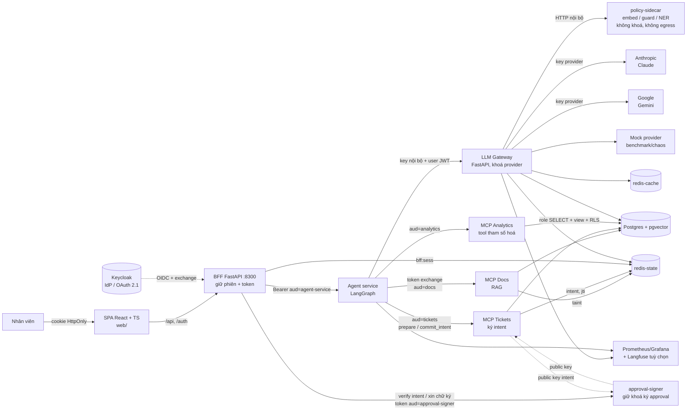
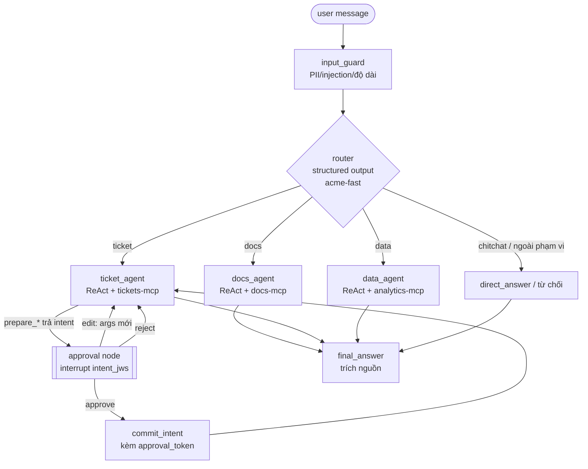

# Giải pháp: Nền tảng trợ lý AI nội bộ doanh nghiệp

> LangGraph điều phối agent · MCP kết nối hệ thống nghiệp vụ · LLM Gateway tự phát triển (bảo mật + kiểm soát chi phí) · Phê duyệt ràng buộc giao dịch
>
> Phiên bản 1.3, 2026-10-29 (D15: UI React + TS + BFF thay Chainlit). Đây là **dự án sản phẩm phát triển tự do**: nền tảng trợ lý AI nội bộ self-host, hướng tới chạy được thật trong doanh nghiệp. Lộ trình theo milestone (xem [`ROADMAP.md`](ROADMAP.md)); mục tiêu số là SLO/tiêu chí chấp nhận (acceptance). Research chi tiết nằm ở `docs/research/01..04`; lý do các thay đổi v1.2 ở `docs/reviews/review-01-opus.md` và `design/DECISIONS-v1.2.md`.
>
> **Thiết kế chi tiết** (đọc theo thứ tự):
> - [`design/00-contracts.md`](design/00-contracts.md): cổng, mạng, **Redis keyspace (2 instance)**, schema Postgres + RLS, JWT/Keycloak, intent + approval token, mã lỗi, env, luồng tổng
> - [`design/01-gateway.md`](design/01-gateway.md): pipeline, Lua rate limit/breaker, adapter, PII, guard, cache, router, audit
> - [`design/02-mcp-servers.md`](design/02-mcp-servers.md): auth middleware, RAG hybrid search, ticket + intent/approval, analytics tham số hoá
> - [`design/03-agent-ui.md`](design/03-agent-ui.md): state, graph, prompt, HITL, token exchange; UI = React + TS + BFF xem `design/07-web-bff.md`, D15, ADR-002
> - [`design/04-infra-data-eval.md`](design/04-infra-data-eval.md): docker compose, cấu hình Redis/Postgres/Keycloak, dữ liệu giả lập, bộ đánh giá
> - [`design/DECISIONS-v1.2.md`](design/DECISIONS-v1.2.md): các quyết định D0–D12 (thắng khi mâu thuẫn)

---

## 1. Vì sao xây nền tảng này

Doanh nghiệp muốn nhân viên hỏi đáp và thao tác trên dữ liệu nội bộ (tài liệu, ticket, CRM/DB) qua AI, nhưng có ba nỗi lo:

| Nỗi lo | Biểu hiện | Lớp giải quyết |
|---|---|---|
| **Lộ API key** | Key provider rải rác trong từng app, từng máy dev | Gateway giữ key provider duy nhất; app chỉ cầm key nội bộ (hash, thu hồi được) |
| **Mất kiểm soát chi phí** | Không biết phòng ban nào tiêu bao nhiêu; dùng model đắt cho câu hỏi dễ | Đếm token + chi phí theo key/phòng ban, budget, rate limit, cache có kiểm soát, routing model rẻ |
| **AI truy cập vượt quyền / bị lừa thao tác** | Agent đọc tài liệu/ticket của phòng ban khác; prompt injection khiến agent thực thi lệnh ghi hoặc khiến người duyệt bấm "Duyệt" trên một thẻ sai | MCP server tự kiểm quyền theo danh tính user; thao tác ghi đi qua **phê duyệt ràng buộc giao dịch** (mục 6.3) |

### Vì sao tự xây gateway thay vì dùng gateway có sẵn

Quyết định dựa trên **yêu cầu kiến trúc**, không dựa vào một sự cố cụ thể:
1. **Uỷ quyền theo từng user.** Chi phí, budget, chính sách PII và audit phải tính theo danh tính người dùng cuối (token Keycloak đi xuyên agent → gateway → MCP), không chỉ theo API key của ứng dụng.
2. **PII tiếng Việt.** CCCD, SĐT, STK, biển số, tên người Việt cần recognizer riêng và chính sách `mask/block/allow` theo phòng ban.
3. **Audit chống sửa.** Hash chain HMAC với khoá ngoài DB và anchor ra kho append-only, gắn với danh tính user và quyết định PII/guard.
4. **Bề mặt tấn công nhỏ.** Gateway là nơi tập trung toàn bộ khoá provider. Giữ nó nhỏ: không có endpoint cấu hình động, không nạp model ML nặng (đẩy sang `policy-sidecar` không có khoá, không egress), ít dependency, lock có hash, image pin digest.

**Bối cảnh rủi ro chuỗi cung ứng.** Các sự cố gateway mã nguồn mở năm 2026 cho thấy rủi ro của một thành phần giữ toàn bộ khoá:
- Phần **có advisory chính thức**: CVE-2026-42208 (SQL injection trước xác thực, giá trị header `Authorization` ghép thẳng vào câu SQL; có GHSA/OSV, cần ghi lại mã định danh khi đối chiếu) và sự cố phát hành 10/2026 trên PyPI/Docker chứa mã đánh cắp credential (Microsoft Security Blog, 23/10/2026).
- Phần còn lại, gồm vụ 03/2026 (v1.82.7–1.82.8 bị cài mã độc qua credential PyPI bị đánh cắp, liên quan chuỗi TeamPCP/Trivy) và các CVE khác: **theo báo cáo của báo chí bảo mật, chưa xác minh** với advisory gốc. Chi tiết ở `research/01`; mục 11 liệt kê việc đối chiếu.

Đây là ngữ cảnh chứ không phải luận cứ chính. Lựa chọn tự xây phải tự chứng minh bằng bộ đánh giá (mục 9): overhead, chịu lỗi, và security regression.

## 2. Phạm vi theo milestone

| Milestone | Nội dung chính | Kết quả chạy được |
|---|---|---|
| **M0 Spikes** | Time-box 2 ngày/spike, mỗi spike có phương án B (SDK MCP + identity, token exchange, BFF OIDC + exchange 2 audience (luật Keycloak V2), serializer mã hoá checkpoint, pilot Prompt Guard 2 tiếng Việt) | ADR chốt công nghệ |
| **M1 v0.1 Walking skeleton** | BFF + SPA tối thiểu (login, chat streaming, thẻ duyệt, trích nguồn, chi phí) → agent (router + HITL) → gateway mỏng (auth key + user token + 1 provider + mock + usage) → docs-mcp (search + ACL) + tickets-mcp (đọc + `close_ticket` qua intent/approval) | `docker compose up` chạy đầu-cuối |
| **M2 v0.2 Gateway production-core** | Rate limit, budget, 2 provider + fallback/breaker, exact cache, PII regex VN, audit chain HMAC, Prometheus/Grafana | Gateway đủ dùng nội bộ |
| **M3 v0.3 Nghiệp vụ đầy đủ** | tickets-mcp đủ tool ghi qua intent; analytics-mcp chỉ tool tham số hoá; checkpoint mã hoá + retention; taint | Đủ luồng nghiệp vụ |
| **M4 v0.4 Policy sidecar & tối ưu chi phí** | policy-sidecar (embed/guard/NER); router `acme-auto`; semantic cache có kiểm soát; pilot guard tiếng Việt | Giảm chi phí đo được |
| **M5 v0.5 Bộ đánh giá & red-team** | Benchmark, security regression suite trong CI, user study phê duyệt | Báo cáo đánh giá |
| **M6 v0.6 Trang admin + polish UX** | Trang admin (key, budget, chi phí theo phòng ban), polish UX, a11y, i18n (BFF + SPA đã có từ M1) | UI sản phẩm |
| **M7 v1.0 Production hardening** | TLS nội bộ, HA, secret manager, backup/PITR, runbook, SLO + alert | Phát hành 1.0 |
| **Tuỳ chọn sau v1.0** | Raw SQL analytics (HMAC ctx), so sánh LiteLLM/Portkey, Langfuse, step-up WebAuthn/CIBA, Jira adapter | — |

**Ngoài phạm vi:** fine-tune model, đa tenant SaaS thật, tích hợp CRM thương mại (thay bằng DB giả lập cho dev/eval). Kubernetes chỉ ở dạng Helm chart tuỳ chọn.

**Dữ liệu dev/eval:** công ty giả lập "ACME Việt Nam" với 4 phòng ban (Kinh doanh, Kỹ thuật, Nhân sự, CSKH), ~200 tài liệu nội bộ (quy chế, quy trình, FAQ, có tài liệu mật theo phòng ban), ~2.000 ticket, DB bán hàng/khách hàng. Toàn bộ sinh tổng hợp nên không có dữ liệu thật.

## 3. Kiến trúc tổng thể



Mạng `core` là `internal`; chỉ `gateway` có đường ra Internet. `policy-sidecar` và `approval-signer` chỉ ở `core`.

**Nguyên tắc xuyên suốt**
- **Danh tính đi xuyên suốt:** user đăng nhập qua Keycloak. Agent dùng **token exchange (RFC 8693)** để lấy token riêng cho từng MCP server (audience riêng), không chuyển tiếp nguyên token của user (đúng yêu cầu spec MCP 2026-07-28). Gateway cũng nhận danh tính user để tính chi phí, PII và audit.
- **Phân quyền nằm ở server, không nằm ở prompt.** LLM có bị injection thì cũng chỉ làm được những gì user đó vốn được phép.
- **Giả định đe doạ: agent có thể bị chiếm hoàn toàn.** Vì vậy mọi thao tác ghi phải có người duyệt trên dữ liệu do **server tính và ký** (mục 6.3).
- **Ít phụ thuộc, pin bằng hash:** gọi provider bằng `httpx` trực tiếp, `uv.lock` có hash, image Docker pin digest, model ML pin revision + sha256 trong `models.lock`.
- **Ports & Adapters:** mọi tích hợp ngoài nằm sau port; thêm vendor = thêm file adapter, không sửa nghiệp vụ (`design/00-contracts.md` §9).

## 4. Lớp 1: LLM Gateway (egress mỏng) + policy-sidecar

### 4.1 Pipeline xử lý một request

```
Request ─► [1] AuthN key ─► [2] AuthZ model/budget ─► [3] Rate limit (RPM+TPM)
        ─► [4] PII mask (regex; NER qua sidecar) ─► [5] Injection screen (sidecar, tuỳ chọn)
        ─► [6] Router ─► [7] Exact cache lookup (M4: semantic, tuỳ chọn)
        ─► [8] Provider adapter + circuit breaker + fallback
        ─► [9] Stream/convert về format OpenAI ─► [10] PII unmask ─► [11] Usage & cost ─► [12] Audit log
```

| Bước | Thiết kế | Ghi chú bảo mật/hiệu năng |
|---|---|---|
| 1. Xác thực | Key dạng `sk-acme-<prefix>.<secret>`; DB chỉ lưu `prefix` và `HMAC-SHA256(key=pepper, msg=secret)`; so sánh constant-time | Truy vấn **luôn tham số hoá**. Cache key hợp lệ trong Redis TTL 300s (+ L1 10s); **thu hồi** = xoá cache + Redis pub/sub -> hiệu lực < 1s |
| 2. Phân quyền | Mỗi key gắn `department`, `allowed_models`, budget, `max_tokens` | Hết budget -> 402 có thông báo rõ |
| 3. Rate limit | Token bucket Redis bằng Lua (atomic), request/phút và token/phút; theo key + phòng ban + user | Ước lượng token đầu vào trước, trừ phần chênh sau khi có usage thật |
| 4. Lọc PII | `regex_vi` thuần Python (CCCD, SĐT, STK, email, biển số; PERSON theo danh xưng với stop-word, ≥ 2 âm tiết viết hoa, đo precision riêng) + NER tên người (underthesea CRF) gọi qua `policy-sidecar /v1/pii/ner` với `skip_on_error`. **Pseudonymization đảo ngược:** `Nguyễn Văn A` -> `<PERSON_1>`, bảng ánh xạ chỉ trong RAM của request | Chính sách theo phòng ban: `mask/block/allow`. Presidio chỉ là baseline ngoài tuỳ chọn |
| 5. Chống injection | Llama Prompt Guard 2 (ONNX) chạy trong **policy-sidecar**; gateway gọi `/v1/guard` với timeout và fail-policy theo loại nội dung (D17): đoạn tool/RAG lỗi -> thay bằng `[nội dung đã ẩn: không kiểm tra được an toàn]` (`redact`, request vẫn chạy); prompt của chính user -> `open` (mặc định, có metric) hoặc `closed` | **Chỉ bật sau khi pilot tiếng Việt** (50 mẫu độc + 50 mẫu lành) đạt ngưỡng ở M4 |
| 6. Routing | Alias `acme-fast`, `acme-smart`, `acme-auto` (classifier độ khó). Router chạy trước cache nên cache key dùng alias đã resolve | Nguồn tiết kiệm chính cùng provider prompt caching |
| 7. Cache | **M2: exact cache**, khoá có `sub` (per-user); chỉ per-scope khi admin bật cho alias/system prompt "public FAQ". **M4 (tuỳ chọn bật): semantic cache** chỉ populate từ nguồn tin cậy (FAQ đã duyệt, warm-up của admin), không populate từ response user thường, luôn per-scope | Header `x-acme-cache` và `x_acme.cache` chỉ cho key admin/EVAL (chống dò cache). Không cache response có tool call, request có PII. Hit-rate đo trên **trace agent thật** |
| 8. Provider | Adapter `Anthropic`, `Gemini`, `Mock` sau port `ChatProvider`; retry backoff, timeout, **circuit breaker** theo provider, chuỗi fallback theo alias | `acme-fast`: Claude Haiku 5.5 -> Gemini 2.5 Flash-Lite |
| 9. Format | Chuẩn hoá về Chat Completions của OpenAI, cả tool calling và SSE delta | Test tương thích bằng `openai` SDK và `ChatOpenAI` |
| 11. Usage & cost | Lấy `usage` từ provider; chi phí qua `x-acme-cost-usd` (non-stream) hoặc `x_acme` ở chunk cuối + `GET /v1/requests/{id}`; giá từ `pricing.yaml` có `effective_from` | Bảng `usage_events` (có `sidecar_ms` để phân rã độ trễ); Grafana theo phòng ban/ngày/model |
| 12. Audit | Bảng append-only: ai, key nào, model, token, chi phí, quyết định PII/guard, hash prompt (không lưu plaintext). **Hash chain HMAC-SHA256 với khoá `AUDIT_HMAC_KEY` ngoài DB** + **anchor mỗi giờ** ký và ghi ra kho append-only ngoài DB (dev: thư mục chỉ-append + git repo `audit-anchors`; prod: bucket object-lock) | Giới hạn ghi rõ: không chống kẻ có cả quyền DBA lẫn khoá HMAC |

**Degraded mode khi Redis state lỗi:** hạn mức in-memory = limit / (số worker × số instance), chỉ phục vụ alias rẻ `acme-fast`, TTL L1 của key ≤ 30s để thu hồi vẫn có hiệu lực, metric `gw_degraded_overspend_max_usd`; sau 600s trả 503 `service_unavailable`.

**policy-sidecar** (cổng 8010, `core` only, không khoá, không egress): `/v1/embed` (bge-m3 ONNX), `/v1/guard` (Prompt Guard 2), `/v1/pii/ner` (underthesea). Gateway **không** nạp onnxruntime/torch/tokenizers/model HF. Ingest của docs-mcp và query dùng **cùng một runtime embedding** (qua alias `acme-embed`). Supply chain model: `models.lock` (revision commit sha, sha256 từng file, license), tải bằng `huggingface_hub` với `trust_remote_code=False`, chỉ `*.safetensors`/`*.onnx`; sidecar verify hash khi khởi động; ghi rõ license (Prompt Guard 2: Llama license; bge-m3: MIT; underthesea: kiểm tra GPL).

**Bảng model đề xuất** (giá USD/1M token in/out, lấy ngày 2026-10-28, phải kiểm tra lại trước khi phát hành):

| Alias | Chính | Fallback |
|---|---|---|
| `acme-fast` | Claude Haiku 5.5 ($0.10/$0.50) | Gemini 2.5 Flash-Lite ($0.10/$0.40) |
| `acme-smart` | Claude Sonnet 5.5 ($2/$10) | Gemini 3.1 Pro Preview ($2/$12) |
| `acme-embed` | bge-m3 chạy local trong policy-sidecar (không gửi dữ liệu ra ngoài) | n/a |
| `acme-judge` | Gemini 3.1 Pro Preview (khác họ với agent), chỉ key EVAL | Claude Sonnet 5.5 |

**Admin API** (`/admin/*`, chỉ role admin trong Keycloak): tạo/thu hồi key, đặt budget, xem usage. Không có endpoint kiểu "update config", "test MCP" hay "tuỳ chỉnh `api_base`" (đúng là các bề mặt đã bị khai thác ở các gateway khác).

## 5. Lớp 2: MCP servers

Ba server dùng SDK Python (`mcp` 2.x hoặc `fastmcp` 4.x, **chốt sau spike M0**; phương án B: FastAPI tool server tự viết), transport Streamable HTTP, đóng vai OAuth resource server: có Protected Resource Metadata, kiểm tra `aud`, `iss`, `exp`, scope.

| Server | Tool | Kiểm soát quyền |
|---|---|---|
| **docs-mcp** (RAG) | `search_documents(query, top_k)`, `get_document(doc_id)` | Lọc ACL **trong SQL** + RLS theo claims của token, không theo tham số LLM. Kết quả được **spotlighting** (delimiter, datamark, `source`, `trust: untrusted`). Ghi taint theo thread và phòng ban (`mcp:taint:{sub}:{thread_id}` + `:recent` 24h; D17) |
| **tickets-mcp** | Đọc: `list_my_tickets`, `get_ticket`, `search_tickets`. Ghi: cặp `prepare_<op>` + `commit_intent` cho `create_ticket`, `add_comment`, `update_status`, `close_ticket` | Scope `tickets:read` / `tickets:write`; RLS theo requester/assignee. `prepare_*` **không đổi dữ liệu**, trả intent JWS do chính tickets-mcp ký; `commit_intent` đòi approval token khớp intent (mục 6.3). Audience đích tính bằng `acme.ticket_audience(draft)` (suy từ RLS `tk_select`); nếu người đọc có thể thấp clearance hơn hoặc khác phòng ban so với taint của thread/`recent` -> `risk_flags:["possible_downgrade"]` |
| **analytics-mcp** (DB chỉ đọc) | **Chỉ tool tham số hoá**: `sales_summary(period, region)`, `top_customers(period, n)`, `customer_lookup(name)` | Role Postgres chỉ `SELECT` trên view `security_barrier` đã mask PII; RLS `FORCE`; mọi quyền cột PII trên bảng gốc bị thu hồi; `default_transaction_read_only=on`, `statement_timeout=3s`. `run_readonly_sql` (sqlglot allowlist + HMAC ctx) **chuyển sang tuỳ chọn sau v1.0**, thiết kế giữ trong `00-contracts` §3.4 |

Biện pháp chung: mô tả tool được pin và băm (phát hiện rug pull); output giới hạn kích thước; mọi lần gọi tool đều ghi audit. Audit của tool ghi được ghi **đồng bộ trong cùng transaction** với `UPDATE`.

## 6. Lớp 3: Agent LangGraph

### 6.1 Graph



- **LangGraph 1.2.x**, `StateGraph` tự viết: node classifier + `add_conditional_edges`, mỗi agent con là một subgraph. Không dùng `langgraph-supervisor`, vì router đơn giản thì dễ đo routing accuracy hơn.
- LLM: `ChatOpenAI(base_url=GATEWAY_URL, api_key=<key của service agent>, model="acme-smart", stream_usage=True, default_headers={"X-Acme-User-Token": ...})`, dựng qua hàm `make_chat_model(role)`.
- MCP: `langchain-mcp-adapters`, **tạo client theo request** để gắn token đã exchange cho đúng user.
- Checkpointer: `PostgresSaver` với **serializer mã hoá mặc định**, `thread_id` = phiên chat; retention 30 ngày + API xoá thread.

### 6.2 Human-in-the-loop
Node `approval` gọi `interrupt({"intent_jws": ...})`. Agent **không dựng preview**: mọi trường hiển thị lấy từ intent do tickets-mcp ký và được approval-signer xác minh. Code trước `interrupt()` phải idempotent vì node chạy lại khi resume.

### 6.3 Phê duyệt ràng buộc giao dịch (What You See Is What You Sign)
Đây là **điểm khác biệt chính của sản phẩm**. Giả định: agent có thể bị chiếm hoặc bị lừa hoàn toàn, nên người dùng không bao giờ ký trên dữ liệu do agent hay UI tự dựng.

Thành phần: **`approval-signer`**, service riêng nhỏ (≤ ~300 dòng, không dependency nặng, mạng `core`, không egress, cổng 8310), giữ khoá riêng ES256 ký approval. BFF/SPA không giữ khoá.

Luồng:
1. Agent gọi `prepare_close_ticket(args)`; tickets-mcp **tự đọc DB**, tính intent `{intent_id, op, target, before, after, expected_updated_at, args_canonical, sub, risk_flags, iat, exp=iat+300}`, ký JWS bằng khoá intent của tickets-mcp, lưu hash + `sub` + `status` vào Redis (TTL 330s = `exp` + 30s).
2. Agent `interrupt({intent_jws})`.
3. BFF token-exchange (RFC 8693) token đăng nhập lấy token `aud=approval-signer` (chỉ client `chat-ui` được phép, giữ trong session server, agent và trình duyệt không thấy), rồi gửi `intent_jws` tới `approval-signer /v1/intents/verify`; signer kiểm `aud`, `azp == chat-ui`, chữ ký MCP, `exp`, `sub == intent.sub`, trả **render model** (before/after/`display_fields` phủ toàn bộ trường được ký/risk_flags; trường không hiển thị được -> `422 intent_unrenderable`). SPA chỉ render từ đây.
4. User bấm Duyệt -> SPA gọi BFF `/api/approvals`, BFF gọi signer `/v1/approvals`; signer xác minh token đã exchange (JWKS, iss, aud, azp, exp) và ký **approval token** `{iss, aud:"tickets-mcp", sub, intent_id, intent_sha256, jti, iat, exp=iat+120}`.
5. Agent gọi `commit_intent(intent_id, approval_token)`. tickets-mcp kiểm chữ ký, `sub == caller.sub`, intent tồn tại + hash khớp + còn `pending`, `jti` dùng một lần; thực thi với `expected_updated_at` (TOCTOU -> `conflict`); ghi `ticket_events` + `tool_audit` trong cùng transaction.
6. **Sửa:** agent gọi lại `prepare_*` để có intent mới; không bao giờ ký args do UI/agent dựng.

**Tách token (D13, cập nhật theo D15; sửa N01/N02):** token đăng nhập (client `chat-ui`, BFF giữ) có `aud=chat-ui` và **không** gửi cho agent. BFF exchange thành `aud=agent-service` (gửi agent mỗi request) và `aud=approval-signer` (chỉ trong session server). `agent-service` exchange sang `llm-gateway` + 3 MCP, không tới signer. Signer kiểm `azp == chat-ui`. Agent bị chiếm vì vậy không có token hợp lệ để tự gọi `/v1/approvals` (nhận `401/403`); test regression dùng **chính token agent cầm**, không dùng token dựng riêng. Cấu hình phụ thuộc luật exchange V2 của Keycloak (client gọi exchange phải nằm trong `aud` của subject token), xác minh ở spike M0.

Mã lỗi: `intent_not_found`, `intent_expired`, `intent_mismatch`, `approval_*`, `conflict`.
**HITL, taint, guard sau D17 (N05–N07, N12, N13, N15).** Intent đang chờ nằm ở Redis cùng JWS (ACL chỉ user `tickets`) và `commit_intent` verify lại chữ ký; việc commit đi qua một máy trạng thái `pending -> committing -> committed | failed` (định nghĩa duy nhất ở 00 §4.2), nên hai commit song song chỉ có một thành công và crash giữa chừng được khôi phục từ `ticket_events.intent_id UNIQUE`. Từ chối không có tool huỷ: BFF nhớ intent đã từ chối 10 phút và giới hạn 10 thẻ/thread/giờ. Taint theo thread + phòng ban nên không còn hết hạn sau 30 phút. Khi sidecar lỗi, đoạn tool/RAG chưa kiểm tra bị che thay vì lọt qua, và request tới provider ngoài bị từ chối (`503 policy_unavailable`) nếu không chạy được NER.

**Rủi ro còn lại:** BFF bị chiếm có thể xin chữ ký cho intent của chính user đang đăng nhập. Giảm thiểu bằng BFF tối giản, token không xuống trình duyệt, CSP chặt từ M1; tuỳ chọn step-up (WebAuthn/CIBA) cho thao tác rủi ro cao sau v1.0.

## 7. Giao diện & vận hành
- **Chat UI: React 18 + TypeScript (Vite) SPA + BFF FastAPI** ngay từ MVP (D15, ADR-002; thay Chainlit/ADR-001). BFF (`packages/bff`, 8300) phục vụ SPA cùng origin, đăng nhập OIDC code + PKCE (client `chat-ui`), giữ phiên ở `redis-state` (`bff:sess:{sid}`) và token phía server; trình duyệt chỉ có cookie `HttpOnly`/`SameSite=Strict` + CSRF header. Thẻ duyệt render từ render model của signer (mọi trường được ký, ký tự bidi/điều khiển hiển thị dạng escape); markdown qua `react-markdown` + `rehype-sanitize`, CSP chặn ảnh/script ngoài. Hiển thị nguồn trích dẫn và chi phí. M6 thêm trang admin + polish UX/a11y/i18n.
- **Observability:** Prometheus metrics từ mọi service (`/metrics` yêu cầu bearer `METRICS_TOKEN`), Grafana dashboard; **Langfuse self-host** là tuỳ chọn (profile `obs`, bản v3 nặng), chỉ nhận metadata hoặc nội dung đã mask; log không chứa nội dung hội thoại.
- **Hạ tầng:** `docker compose` gồm postgres (pgvector), redis-state, redis-cache, keycloak, gateway, policy-sidecar, approval-signer, 3 MCP server, agent, bff (kèm SPA), prometheus, grafana, mock-provider (+ langfuse profile `obs`). Issuer Keycloak cố định `http://keycloak.acme.local:8080/realms/acme` (dev, không TLS). M7: TLS nội bộ, HA, secret manager, backup/PITR.

## 8. Công nghệ

| Thành phần | Lựa chọn | Lý do |
|---|---|---|
| Ngôn ngữ / quản lý gói | Python 3.12, `uv` workspace (monorepo), lock có hash | Một stack; chống supply chain |
| Gateway | FastAPI, httpx, redis-py, SQLAlchemy 2 + asyncpg, Alembic | Async, mỏng, không model ML |
| policy-sidecar | FastAPI + onnxruntime, bge-m3 ONNX, Prompt Guard 2 ONNX, underthesea | Tách phụ thuộc nặng khỏi tiến trình giữ khoá |
| approval-signer | FastAPI + PyJWT + cryptography | Nhỏ, dễ kiểm toán |
| Embedding / vector | bge-m3 (hoặc `AITeamVN/Vietnamese_Embedding`), pgvector | Dữ liệu không rời hệ thống; ACL trong SQL |
| MCP | `mcp` 2.3 / `fastmcp` 4.1 (chốt sau spike) | Spec 2026-07-28 |
| Agent | langgraph 1.2.x, langchain 1.4.x, langchain-openai | HITL `interrupt()` |
| Auth | Keycloak (OIDC, token exchange) | OAuth 2.1 chuẩn, khớp spec MCP |
| UI | React 18 + TS (Vite, TanStack Query, Tailwind + shadcn/ui) + BFF FastAPI (D15) | Thẻ duyệt WYSIWYS, token không xuống trình duyệt, CSP/sanitize chặt từ MVP |
| Test / đánh giá | pytest, k6 hoặc Vegeta, promptfoo, garak, AgentDojo (tham khảo) | Xem mục 9 |

## 9. Bộ đánh giá: benchmark + security regression + user study

Bộ đánh giá gồm ba phần: **(a) benchmark hiệu năng/chi phí**, **(b) security regression suite** chạy trong CI (fail build khi hồi quy), **(c) user study** về phê duyệt. Các mục tiêu số là **SLO/tiêu chí chấp nhận của sản phẩm**.

| # | Câu hỏi | Phương pháp | Chỉ số | SLO / acceptance |
|---|---|---|---|---|
| E1 | Gateway thêm bao nhiêu độ trễ? | Mock provider độ trễ cố định (TTFT 300ms, 50 tok/s); so sánh gọi thẳng và qua gateway, bật dần từng tính năng; 10/50/100/200 RPS; chạy VM Linux cpuset. **Báo cáo phân rã theo stage**, ghi rõ cấu hình có/không gọi sidecar | Overhead p50/p95/p99, throughput, CPU/RAM | p95 < 30 ms khi chưa bật guard/NER |
| E2 | Chịu lỗi khi provider sập? | Chaos trên mock: 5xx, timeout, sập hẳn, chậm dần | Tỉ lệ thành công, thời gian chuyển provider | ≥ 99% thành công khi một provider sập |
| E3 | Tiết kiệm bao nhiêu? | Đo trên **trace agent thật** (replay). Baseline: tất-cả-rẻ, tất-cả-đắt, router ngẫu nhiên cùng tỉ lệ, router oracle; sau đó routing và routing + cache | Chi phí tại **iso-quality** + đường Pareto, cache hit/false-hit | Giảm chi phí ≥ 50% với chất lượng giảm ≤ 3 điểm % |
| E4 | Phê duyệt có chống được đề xuất độc hại? | (1) Tỉ lệ đề xuất độc hại tới được thẻ duyệt và bị duyệt bởi approver mô phỏng "ngây thơ"; (2) **user study 8–12 người**: tỉ lệ duyệt nhầm khi thẻ hiển thị args thô so với intent do server tính; (3) **fault-injection** (agent độc: đổi args, replay `jti`, đổi ticket sau duyệt, intent giả, ký sai key) đếm số lần MCP từ chối, coi như kiểm thử thuộc tính bảo mật | ASR, tỉ lệ duyệt nhầm, số lần từ chối | Fault-injection: 100% bị từ chối; ASR thao tác ghi = 0% |
| E5 | Key bị thu hồi | Thu hồi giữa lúc chạy tải | Thời gian tới khi request đầu bị từ chối | < 1 s |
| E6 | Vượt quyền qua MCP | User khác phòng hỏi tài liệu mật; đọc/đóng ticket người khác; token sai audience; SQLi/DDL qua tool analytics; cache chéo user | Số lần truy cập trái phép thành công | 0 |
| E7 | Rò rỉ PII ra provider | Tập test chính **≥ 300 câu viết tay** (không dấu, viết tắt, số tách; tập sinh chỉ làm dev); so `regex` với `regex+CRF`; CI theo entity (Wilson) | Precision/recall theo entity | Recall ≥ 95% với CCCD/SĐT/email |
| E8 | Chất lượng agent | ≥ 150 câu có nhãn, ≥ 2 model; 20% quyết định reject/edit; Wilson CI theo nhóm | Routing accuracy, task success, faithfulness | Routing ≥ 90% |
| E9 | (tuỳ chọn sau v1.0) So sánh gateway | E1/E2 với LiteLLM (bản sạch, pin digest) và Portkey OSS trên cùng mock | Overhead, số dependency, số endpoint | Định tính + định lượng |

**Phương pháp dữ liệu:** ≥ 100 mẫu gán nhãn bởi người; đo độ đồng thuận người–người và người–judge (κ); judge khác họ với agent (`acme-judge`, Gemini trước); báo cáo riêng trên phần viết tay; công bố seed, prompt, phiên bản. **Guard pilot** (50+50 mẫu tiếng Việt) là điều kiện để bật guard ở M4.

Ánh xạ kết quả vào **OWASP Top 10 for LLM 2025** (LLM01, 02, 03, 05, 06, 08, 10) và **OWASP Agentic Top 10 2026**.

## 10. Rủi ro & hướng giảm thiểu

| Rủi ro | Giảm thiểu |
|---|---|
| API lấy danh tính caller trong `mcp` 2.x / `fastmcp` 4.x chưa rõ; SDK stateless | Spike M0 (2 ngày); phương án B: FastAPI tool server + middleware ASGI kiểm JWT |
| Keycloak token exchange cấu hình phức tạp | Phương án B: client-credentials + header `X-Acme-User-Token` đã verify; ghi rõ là giới hạn |
| Hai ngôn ngữ (Python + TS), thêm pipeline Node; M1 dài thêm ~1–1,5 tuần | Job CI `web` riêng (lockfile, lint, typecheck, vitest, build, Playwright); type TS sinh từ OpenAPI của BFF; quy tắc frontend (một `request()`, component không gọi `fetch`, leak-grep `web/src`) |
| Serializer mã hoá checkpoint LangGraph không hỗ trợ như kỳ vọng | Spike M0; dự phòng: mã hoá cột ở lớp lưu trữ + retention ngắn |
| Prompt Guard 2 kém trên tiếng Việt (nhiều false positive/negative) | Pilot 50+50 mẫu trước khi bật; mặc định tắt; fail-policy cấu hình được |
| Sidecar chậm hoặc lỗi làm hỏng đường nóng của gateway | Timeout + fail-policy theo loại nội dung (D17, N15): tool/RAG `redact` theo đoạn, prompt user `open`, NER ra provider ngoài `closed` (`503 policy_unavailable`); sidecar có pool và `max_inflight` riêng theo lớp ưu tiên (guard/NER online > embed truy vấn > embed ingest); metric `gw_policy_skipped_total`/`gw_policy_redacted_total`, alert khi skipped > 0 trong 5 phút; báo cáo độ trễ có/không sidecar |
| Taint hết hạn/ trốn bằng `thread_id` giả hoặc qua phòng ban (N12) | Đã giảm thiểu: khoá `mcp:taint:{sub}:{thread_id}` (TTL = retention thread) + `:recent` 24h; `docs`, `analytics`, `tickets.get_ticket` đều ghi; `possible_downgrade` tính theo `acme.ticket_audience(draft)` cả mức lẫn phòng ban; ca regression qua ngày/qua phòng ban ở M3/M5 |
| Sidecar quá tải làm nội dung tool/RAG hoặc tên người lọt tới provider (N15) | Đã giảm thiểu: fail-closed theo đoạn cho tool/RAG, NER fail-closed với provider ngoài, ingest không làm đói online; ca regression quá tải ở M4/M5 |
| Supply chain model (pickle độc, đổi revision) | `models.lock`, chỉ `*.safetensors`/`*.onnx`, `trust_remote_code=False`, verify hash lúc khởi động |
| PII tiếng Việt khó nhận diện (tên người) | Regex cho định danh có cấu trúc + NER; test ≥ 300 câu viết tay; báo cáo precision/recall trung thực |
| Agent tự xin approval (gọi `/v1/approvals` bằng token của mình) | Đã chặn bằng D13/D15: token gửi agent (`aud=agent-service`) không dùng được cho signer; Keycloak không cho `agent-service` exchange tới signer; signer kiểm `azp == chat-ui`; test dùng chính token agent cầm; có ca security regression |
| BFF bị chiếm xin chữ ký cho intent của chính user | **Rủi ro còn lại.** BFF tối giản (≤ vài trăm dòng logic), không giữ khoá ký, token không xuống trình duyệt, CSP chặt; tuỳ chọn step-up WebAuthn/CIBA sau v1.0 |
| Cache rò chéo user hoặc bị dò | Khoá có `sub`, semantic cache chỉ từ nguồn tin cậy, ẩn header cache với user thường, canary test trong CI |
| Redis state lỗi | Degraded mode có chặn trên chi tiêu, chỉ alias rẻ, hết 600s trả 503 |
| Audit bị DBA sửa | HMAC khoá ngoài DB + anchor append-only; ghi giới hạn |
| Chi phí API khi đánh giá | Mock cho E1/E2/E5/E6; Haiku/Flash-Lite cho phần lớn E3/E4; budget cứng 160 USD phòng EVAL (dự kiến ~130 USD; key `eval-regression` cho nightly) |
| Spec/SDK thay đổi nhanh (MCP stateless 2026-07-28) | Pin version, ghi ADR, lớp adapter mỏng |
| Phạm vi lớn | Đi theo milestone M0–M7, mỗi milestone có Definition of Done; mục "Tuỳ chọn sau v1.0" tách riêng |

## 11. Việc cần xác minh thêm (reader)
1. API danh tính/auth của `mcp` 2.3.0 và `fastmcp` 4.1.4; hành vi stateless.
2. Tên 10 mục OWASP Agentic Top 10 2026 (trang chính thức).
3. Keycloak bản hiện hành: token exchange (RFC 8693) đã GA chưa; có phát claim `act` không.
4. Advisory gốc của sự cố gateway mã nguồn mở (GHSA/OSV, blog nhà phát hành) để thay các mục đang ghi "chưa xác minh" ở mục 1.
5. Spike BFF: luật Keycloak exchange V2 với 2 audience (`agent-service`, `approval-signer`) từ client `chat-ui`; SSE qua POST + `interrupt` qua BFF.
6. Serializer mã hoá của `langgraph-checkpoint-postgres` (API chính xác).
7. Điều khoản license: Prompt Guard 2 (Llama license), underthesea (GPL?).
