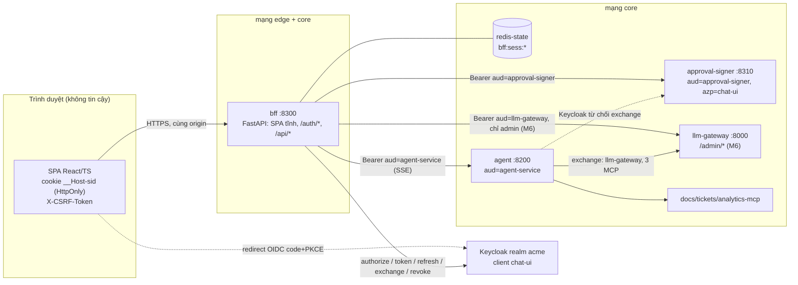

# 07 — Web UI: SPA React + TypeScript và BFF

> Phiên bản 1.3, 2026-10-29. Thiết kế chi tiết cho quyết định **D15** (`DECISIONS-v1.2.md`, thắng mọi mâu thuẫn) và `docs/adr/ADR-002-ui-react-bff.md` (thay ADR-001 Chainlit). Tuân thủ `00-contracts.md` (nguồn chân lý, §9 Ports & Adapters). Sửa N01, N02, N03 của `docs/reviews/review-02-opus.md`. Liên quan: `03-agent-ui.md` (API agent mục 1.3/1.4, hợp đồng mục 9), `05-approval-flow.md` (signer, intent, render model).
> Code là minh hoạ thiết kế, chưa nằm trong repo. Chỗ API thư viện/Keycloak chưa xác minh ghi **[SPIKE]**; việc xác minh gom ở mục 8.
> Phạm vi: `packages/bff` (service `bff`, cổng 8300), `web/` (SPA), trang admin (M6). Không bao gồm agent, signer, gateway.

## 0. Tóm tắt

| Điều | Quyết định |
|---|---|
| Hình thái | Một origin duy nhất: BFF FastAPI phục vụ SPA đã build + `/auth/*` + `/api/*`. Không CORS. Dev: Vite 5173 proxy sang 8300 |
| Trình duyệt giữ gì | Chỉ cookie phiên `HttpOnly` (`__Host-sid`) và cookie CSRF đọc được bởi JS. **Không** access/refresh/signer token, không `localStorage` cho dữ liệu nhạy cảm |
| BFF giữ gì | Phiên OIDC ở Redis, refresh token mã hoá AES-GCM, token exchange hai audience (`agent-service`, `approval-signer`). **Không** giữ khoá ký |
| Điểm khác biệt sản phẩm | Thẻ duyệt WYSIWYS: SPA chỉ vẽ `display_fields` do `approval-signer` dựng; kiểu lạ ⇒ khoá nút Duyệt; ký tự bidi/điều khiển hiện dạng escape |
| Ranh giới tin cậy | Trình duyệt không tin cậy; SPA là lớp hiển thị; BFF tin cậy một phần (bị chiếm = rủi ro còn lại, mục 7); agent không tin cậy hoàn toàn (`05` mục 1) |

## 1. Kiến trúc tổng



Bất biến của kiến trúc:

1. Token đăng nhập (`aud=chat-ui`) không rời BFF. Agent chỉ nhận token `aud=agent-service`. Token `aud=approval-signer` không rời phiên Redis của BFF (D15, `00-contracts.md` §4).
2. Trình duyệt không bao giờ gửi `intent_jws`, `approval_token` hay token nào: nó gửi định danh (`thread_id`, `interrupt_id`) và BFF tra bản BFF đã nhận từ agent (mục 2.7).
3. Mọi thứ hiển thị trong thẻ duyệt đến từ signer; agent chỉ cung cấp định danh (`03` mục 7.2).
4. BFF là client duy nhất của agent; agent và signer chỉ ở mạng `core`.

## 2. BFF (`packages/bff`)

### 2.1 Cấu trúc module (Ports & Adapters, contracts §9)

Theo D11, BFF chỉ có **một** implementation cho agent và signer nên `AgentClient`, `SignerClient`, `GatewayAdminClient` là **lớp HTTP thường** (không port), test bằng `respx`/`httpx.MockTransport`. Cái cần ẩn vendor là Keycloak: dùng lại port `TokenBroker` (adapter `oauth_token_exchange`) và `TokenVerifier` (adapter `oidc_jwks`) từ `acme_common` (xem mục 9, phụ thuộc #3). Redis dùng trực tiếp (hạ tầng cố định).

```
packages/bff/src/bff/
  ports/            # re-export TokenBroker, TokenVerifier từ acme_common (không import vendor)
  clients/          # lớp HTTP thường, dùng RetryingHttpClient (composition)
    agent_client.py       # AgentClient: threads, messages, run/resume (SSE), evict, request cost
    signer_client.py      # SignerClient: verify_intent, approve
    gateway_admin_client.py   # M6
  services/         # business logic; chỉ phụ thuộc ports + clients + SessionStore
    session.py            # SessionStore (Redis HASH), SessionData
    crypto.py             # AES-GCM seal/open, HKDF từ BFF_SESSION_KEY
    oidc.py               # OidcClient: authorize URL, code exchange, refresh, revoke, end_session (discovery)
    tokens.py             # TokenService: lấy token agent/signer theo phiên (single-flight refresh)
    approval_flow.py      # ApprovalFlow: register_pending, verify, approve, resume
    sse_proxy.py          # SseProxy: parse/validate/forward, heartbeat, huỷ
    csrf.py  rate_limit.py  errors.py (map lỗi)
  api/              # FastAPI routers mỏng: auth.py me.py chat.py threads.py approvals.py admin.py health.py deps.py
  security/         # headers.py (CSP + security headers), origin.py
  factory.py        # registry dict + lazy import: token_broker, token_verifier (đọc Settings)
  settings.py       # pydantic-settings
  main.py           # app factory + lifespan; mount SPA (StaticFiles + fallback index.html)
packages/bff/tests/ (unit/, integration/, security/)
```

`factory.py` dùng registry dict + lazy import như mọi package (không `if/elif`):

```python
# bff/factory.py
_BROKERS: dict[str, Callable[[Settings], TokenBroker]] = {
    "oauth_token_exchange": lambda s: _lazy("acme_common.adapters.oauth_token_exchange").build(s.token_broker),
    "static": lambda s: _lazy("acme_common.adapters.static_token").build(s.token_broker),   # test/dev
}
def build_token_broker(s: Settings) -> TokenBroker:
    try: return _BROKERS[s.token_broker.kind](s)
    except KeyError: raise TokenBrokerNotConfigured(f"unknown; known: {sorted(_BROKERS)}") from None
```

Lưu ý: **không** bọc `TokenBroker` bằng `CachingTokenBroker` khoá theo `sub`: D13/D15 cấm cache token signer sang session khác. BFF tự cache theo phiên trong `SessionStore` (mục 2.3). Leak-grep của §9.1.8 (`keycloak|...`) phải rỗng ngoài `adapters/`, `factory.py`, `settings.py`; `oidc.py` chỉ nói chuyện qua endpoint chuẩn OIDC (discovery URL lấy từ settings), không tên vendor trong mã.

### 2.2 Cấu hình (`settings.py`)

| Biến | Mặc định | Ghi chú |
|---|---|---|
| `BFF_PUBLIC_URL` | — | Origin công khai, vd `https://chat.acme.local`; dùng cho `redirect_uri`, kiểm `Origin`, `post_logout_redirect_uri` (có trong contracts) |
| `BFF_SESSION_KEY` | — | 32 byte base64; HKDF ra `k_enc` (AES-GCM) và `k_csrf` (HMAC) (có trong contracts; bổ sung HKDF) |
| `BFF_OIDC_CLIENT_SECRET` | — | Client `chat-ui` confidential (có trong contracts) |
| `BFF_AGENT_URL`, `BFF_SIGNER_URL` | | `http://agent:8200`, `http://approval-signer:8310` (có) |
| `BFF_SIGNER_TOKEN_TTL_S` | 300 | Trần TTL token signer đang giữ, ≤ 300 (có) |
| `BFF_REDIS_URL`, `REDIS_BFF_PASSWORD`, `METRICS_TOKEN` | `redis://bff@redis-state:6379/0` | (có) |
| `BFF_SESSION_IDLE_S` / `BFF_SESSION_ABS_S` | 1800 / 28800 | Mới: tham số hoá giá trị D15 |
| `BFF_STREAM_MAX_S` | 300 | Mới: trần thời lượng một luồng SSE |
| `BFF_STREAM_IDLE_S` | 45 | Mới: không nhận gì từ agent quá ngần này ⇒ `upstream_timeout` |
| `BFF_LINK_ALLOWLIST` | rỗng | Mới: danh sách host cho phép link trong markdown (mục 3.7) |
| `BFF_GATEWAY_URL` | — | Mới, M6: cho proxy admin |
| `BFF_TRUSTED_PROXY` | `false` | Mới: tin `X-Forwarded-For` để rate limit đăng nhập theo IP |
| `BFF_COOKIE_INSECURE_DEV` | `false` | Chỉ `ACME_ENV=dev`: dùng cookie `sid`/`csrf` (không `__Host-`, không `Secure`) khi chạy http |

Khởi động từ chối chạy nếu `ACME_ENV != dev` mà `BFF_PUBLIC_URL` không phải `https`, hoặc `BFF_SESSION_KEY` thiếu/không đủ 32 byte.

### 2.3 OIDC, phiên và cookie

**OIDC Authorization Code + PKCE (S256)**, client `chat-ui` (confidential, `client_secret_basic`), scope `openid profile`; discovery từ `{KEYCLOAK_ISSUER}/.well-known/openid-configuration` (cache, làm mới khi lỗi). Issuer cố định (contracts §4): trình duyệt và BFF dùng cùng một issuer.

1. `GET /auth/login?return_to=/path`: sinh `state` (256 bit), `nonce`, `code_verifier`; lưu `bff:sess:login:{state}` = `{verifier, nonce, return_to, created_at}` (TTL 600s); đặt cookie `__Host-login=<state>` (HttpOnly, Secure, **SameSite=Lax**, 600s); redirect 302 tới `authorization_endpoint`. `return_to` chỉ nhận đường dẫn nội bộ (bắt đầu bằng `/`, không `//`, không `\`), sai ⇒ `/`.
2. `GET /auth/callback?code&state`: cookie `__Host-login` phải bằng `state` (chống login CSRF) và khoá `login:{state}` phải tồn tại (đọc rồi xoá, dùng một lần). Đổi `code` ở token endpoint kèm `code_verifier`. Xác minh **ID token** (chữ ký JWKS, `iss`, `aud == chat-ui`, `nonce`, `exp`) và access token qua `TokenVerifier` (`aud` chứa `chat-ui`). **Luôn sinh `sid` mới** (chống session fixation), ghi phiên, đặt cookie, xoá `__Host-login`, redirect tới `return_to`. Lỗi bất kỳ ⇒ redirect `/login-error?code=<mã chung>` (không lộ chi tiết).

Vì cookie phiên là `SameSite=Strict`, request điều hướng đầu tiên sau khi trở về từ Keycloak có thể không mang cookie; điều đó vô hại vì `index.html` và asset là tĩnh, công khai; SPA tải xong mới gọi `GET /api/me` (same-site, mang cookie).

**Cookie** (cố định, mục 2.5 cho CSRF):

| Cookie | Thuộc tính | Nội dung |
|---|---|---|
| `__Host-sid` (dev http: `sid`) | `HttpOnly; Secure; SameSite=Strict; Path=/`, không `Domain`, không `Max-Age` | `sid` = 32 byte ngẫu nhiên base64url |
| `__Host-csrf` (dev: `csrf`) | `Secure; SameSite=Strict; Path=/`, JS đọc được | `HMAC(k_csrf, sid)` base64url |
| `__Host-login` | `HttpOnly; Secure; SameSite=Lax; Path=/; Max-Age=600` | `state` (chỉ trong lúc đăng nhập) |

**Phiên Redis** `bff:sess:{sid}` là HASH (khớp contracts §2.1, thêm các trường đánh dấu *mới* cần đưa vào contracts, mục 9). Mọi giá trị nhạy cảm là `base64url(nonce12 || AES-GCM(k_enc, plaintext, AAD = sid || tên trường))`:

```jsonc
// bff:sess:{sid}  (HASH; mỗi trường là một chuỗi)
{
  "v": "1",
  "sub": "5f0c…",                       // từ ID token đã xác minh
  "user": "{\"name\":\"Nguyễn A\",\"email\":\"a@acme.vn\",\"roles\":[\"employee\"],\"depts\":[\"CS\"],\"clearance\":1}",  // mới; để hiển thị, không dùng để cấp quyền
  "created_at": "1793174400",           // epoch giây; hạn tuyệt đối = created_at + BFF_SESSION_ABS_S
  "csrf": "…",                          // HMAC(k_csrf, sid); đối chiếu với header và cookie
  "access_enc": "…", "access_exp": "1793174700",       // token đăng nhập aud=chat-ui (mới: access_enc)
  "refresh_token_enc": "…",             // xoay vòng, mục 2.10
  "id_token_enc": "…",                  // mới: chỉ để id_token_hint khi logout
  "agent_enc": "…", "agent_exp": "…",   // mới: token aud=agent-service (cache theo phiên, TTL ≤ 300s)
  "signer_token": "…(enc)", "signer_exp": "…"           // token aud=approval-signer (TTL ≤ BFF_SIGNER_TOKEN_TTL_S)
}
```

Các khoá phụ cùng tiền tố `bff:sess:` (nằm trong ACL `~bff:sess:*`, user `bff` chỉ có `+@read +@write -@dangerous`, **không** có `MULTI/WATCH/EVAL`, nên thiết kế chỉ dùng lệnh nguyên tử đơn):

| Khoá | Kiểu / TTL | Dùng cho |
|---|---|---|
| `bff:sess:{sid}:pend` | HASH `interrupt_id → JSON`, TTL cùng phiên | Interrupt BFF đã nhận từ agent (mục 2.7), tối đa 5 mục |
| `bff:sess:{sid}:lock` | STRING `SET NX PX 10000` | Single-flight refresh/exchange |
| `bff:sess:{sid}:gate:{interrupt_id}` | STRING `SET NX EX 150` | Chống bấm đúp Duyệt (mục 2.7) |
| `bff:sess:{sid}:rl:{bucket}` | STRING `INCR` + `EXPIRE NX` | Rate limit theo phiên (mục 2.10) |
| `bff:sess:login:{state}` | STRING JSON, TTL 600s | Trạng thái đăng nhập |
| `bff:sess:u:{sha256(sub)[:16]}:appr` | STRING `INCR`, TTL 3600s | Trần 30 approval/giờ theo người dùng (lớp phụ) |

`sid` base64url không chứa `:` nên không thể trùng `login` hay `u`. **Hết hạn:** idle 30 phút trượt và tuyệt đối 8 giờ đều thực thi bằng `EXPIRE` trên mọi khoá của phiên: mỗi request đã xác thực đặt `EXPIRE = min(BFF_SESSION_IDLE_S, created_at + ABS - now)`; `now > created_at + ABS` ⇒ xoá phiên, trả `session_expired`. Redis không có phiên ⇒ `session_expired` (không có fallback trong RAM; Redis chết ⇒ `503 upstream_unavailable`, fail-closed).

```python
# bff/services/session.py (rút gọn)
class SessionStore:
    def __init__(self, redis: Redis, crypto: Crypto, idle_s: int, abs_s: int): ...
    async def load(self, sid: str) -> SessionData | None:
        h = await self.redis.hgetall(f"bff:sess:{sid}")
        if not h or time.time() > int(h["created_at"]) + self.abs_s:
            await self.destroy(sid); return None
        await self._touch(sid, int(h["created_at"]))      # EXPIRE trượt
        return SessionData.from_hash(sid, h, self.crypto)  # giải mã lazily từng trường
    async def update(self, sid: str, **fields: str) -> None:
        await self.redis.hset(f"bff:sess:{sid}", mapping=fields)   # một HSET nguyên tử nhiều trường
```

### 2.4 Luồng token D15

Quy tắc Keycloak (xác minh ở spike C, mục 8): token đăng nhập mang `aud=chat-ui` nhờ audience mapper trên chính client, nên `chat-ui` (client gọi exchange) nằm trong `aud` của subject token, thoả luật standard token exchange V2. Quyền exchange: `chat-ui` → `agent-service` (xin scope `agent:invoke`), `chat-ui` → `approval-signer` (xin scope `signer:approve`); hai scope là optional client scope của `chat-ui`, không nằm trong token đăng nhập (D16; `00` §4); `agent-service` → `llm-gateway` + 3 MCP; **không** có `agent-service` → `approval-signer`.

```mermaid
sequenceDiagram
  autonumber
  actor U as Người dùng
  participant SPA as SPA
  participant BFF as bff
  participant KC as Keycloak
  participant AG as agent
  participant TK as tickets-mcp
  participant SG as approval-signer
  U->>SPA: mở /
  SPA->>BFF: GET /api/me (không cookie) -> 401 session_expired
  SPA->>BFF: điều hướng GET /auth/login
  BFF->>KC: 302 authorize (code + PKCE S256, state, nonce)
  KC-->>BFF: 302 /auth/callback?code&state
  BFF->>KC: token (code + verifier, client_secret)
  KC-->>BFF: access aud=chat-ui, refresh, id_token
  BFF->>BFF: xác minh ID token + access; sid mới; ghi phiên Redis
  BFF-->>SPA: 302 /, Set-Cookie __Host-sid, __Host-csrf
  U->>SPA: "Đóng TCK-000123, đã xử lý xong"
  SPA->>BFF: POST /api/chat (cookie + X-CSRF-Token)
  BFF->>KC: exchange(subject=access aud=chat-ui, audience=agent-service, scope=agent:invoke)
  KC-->>BFF: token A (aud=agent-service, azp=chat-ui)
  BFF->>AG: POST /v1/threads/{id}/runs (Bearer A), SSE
  AG->>TK: prepare_close_ticket (token exchange riêng của agent)
  TK-->>AG: intent_id, intent_jws
  AG-->>BFF: event interrupt {interrupt_id, payload{intent_id, intent_jws, op, expires_at}}
  BFF->>BFF: lưu pend[interrupt_id] = {thread, intent_jws,...}
  BFF-->>SPA: event interrupt {interrupt_id, intent_id, op, expires_at} (không có intent_jws)
  SPA->>BFF: POST /api/intents/verify {thread_id, interrupt_id}
  BFF->>KC: exchange(subject=access aud=chat-ui, audience=approval-signer, scope=signer:approve)
  KC-->>BFF: token S (aud=approval-signer, azp=chat-ui) -> lưu phiên, TTL <= 300s
  BFF->>SG: POST /v1/intents/verify {intent_jws} (Bearer S)
  SG-->>BFF: render model + display_fields (hoặc 422 intent_unrenderable)
  BFF-->>SPA: thẻ duyệt (display_fields)
  U->>SPA: bấm Duyệt
  SPA->>BFF: POST /api/approvals {thread_id, interrupt_id, intent_sha256}
  BFF->>SG: POST /v1/approvals {intent_jws} (Bearer S)
  SG-->>BFF: approval_token (không trả về trình duyệt)
  BFF->>KC: exchange agent (nếu token A sắp hết hạn)
  BFF->>AG: POST /v1/threads/{id}/resume {approve, approval_token} (Bearer A)
  AG->>TK: commit_intent(intent_id, approval_token)
  TK-->>AG: ok
  AG-->>BFF: SSE token, cost, done
  BFF-->>SPA: SSE chuyển tiếp
```

Hệ quả an ninh (là các assert của test, mục 6.3 và F22/F22b của `05`): (i) token A (thứ agent cầm) gọi signer ⇒ `403` vì thiếu `aud=approval-signer`; (ii) token đăng nhập không có `agent-service` hay `approval-signer` trong `aud`; (iii) `agent-service` exchange tới signer ⇒ Keycloak từ chối. Nếu spike C cho thấy luật V2 đòi thêm điều kiện, **không** "sửa nhanh" bằng cách thêm `approval-signer` vào token đăng nhập hay default scope của `chat-ui` (đúng kịch bản hỏng của N01); báo orchestrator.

```python
# bff/services/tokens.py (rút gọn): TokenService dùng port TokenBroker, cache theo phiên
class TokenService:
    def __init__(self, broker: TokenBroker, oidc: OidcClient, store: SessionStore): ...

    async def agent_token(self, s: SessionData) -> str:
        return await self._cached(s, "agent", audience="agent-service", ttl_cap=300)

    async def signer_token(self, s: SessionData) -> str:
        return await self._cached(s, "signer", audience="approval-signer", ttl_cap=self.signer_ttl)

    async def _cached(self, s, slot, *, audience, ttl_cap):
        tok, exp = s.get_token(slot)
        if tok and exp - time.time() > 30: return tok
        async with self.store.single_flight(s.sid):            # SET NX PX 10000 + asyncio.Lock theo sid
            s = await self.store.load(s.sid)                   # đọc lại sau khi giữ khoá
            tok, exp = s.get_token(slot)
            if tok and exp - time.time() > 30: return tok
            subject = await self._login_access_token(s)         # refresh nếu < 60s (mục 2.10)
            at = await self.broker.token_for(subject, audience, frozenset())
            await self.store.update(s.sid, **s.seal_token(slot, at.value, min(at.expires_at, time.time() + ttl_cap)))
            return at.value
```

`TokenExchangeDenied` ⇒ `502 upstream_unavailable` (log cảnh báo + metric `bff_token_exchange_denied_total{audience}`; nhiều lần liên tiếp là dấu hiệu cấu hình Keycloak sai).

### 2.5 CSRF, CSP và security headers

**CSRF** (double-submit có ràng buộc phiên + kiểm Origin). Cookie `__Host-csrf` = `HMAC-SHA256(k_csrf, sid)`; SPA đọc cookie và gửi `X-CSRF-Token` trên mọi request `POST|PUT|PATCH|DELETE` (kể cả `POST` SSE). Middleware chấp nhận khi **đồng thời**: (1) header == cookie (so sánh hằng thời gian); (2) giá trị == `HMAC(k_csrf, sid)` của phiên hiện tại; (3) `Origin` (nếu có) == `BFF_PUBLIC_URL` origin; nếu không có `Origin` thì `Sec-Fetch-Site ∈ {same-origin, none}`. Sai ⇒ `403 csrf_failed`. Bổ sung cho `SameSite=Strict`, không thay thế. `GET` không đổi trạng thái (kể cả `/auth/login`); `/auth/logout` là `POST`.

```python
# bff/security/headers.py
CSP = ("default-src 'self'; script-src 'self'; connect-src 'self'; img-src 'self' data:; "
       "frame-ancestors 'none'; base-uri 'none'; form-action 'self'; object-src 'none'")   # D15 + object-src
class SecurityHeaders(BaseHTTPMiddleware):
    async def dispatch(self, req, call_next):
        r = await call_next(req)
        r.headers.update({
            "Content-Security-Policy": CSP,
            "X-Content-Type-Options": "nosniff",
            "Referrer-Policy": "no-referrer",
            "X-Frame-Options": "DENY",                                   # dự phòng cho frame-ancestors
            "Cross-Origin-Opener-Policy": "same-origin",
            "Cross-Origin-Resource-Policy": "same-origin",
            "Permissions-Policy": "camera=(), microphone=(), geolocation=(), payment=(), usb=(), interest-cohort=()",
        })
        if settings.https: r.headers["Strict-Transport-Security"] = "max-age=31536000; includeSubDomains"
        if req.url.path.startswith(("/api/", "/auth/")): r.headers["Cache-Control"] = "no-store"
        return r
```

Quy tắc build để CSP đứng vững: không script/style inline (Vite xuất file riêng; `index.html` không có `<script>` nội tuyến), không `eval`/`new Function`, không CDN/font ngoài (font tự host). Style động của thư viện UI chạy qua CSSOM (được phép); nếu spike phát hiện thành phần cần `style-src-attr`, nới đúng chỗ đó và ghi lý do, **không** thêm `'unsafe-inline'` cho `script-src`. `img-src 'self' data:` đồng thời là lớp thứ hai chặn exfil bằng ảnh markdown (mục 3.7). Asset có hash trong tên ⇒ `Cache-Control: public, max-age=31536000, immutable`; `index.html` ⇒ `no-cache`. Test CSP ở mục 6.4.

### 2.6 Endpoint

Quy ước: mọi lỗi có dạng `{"error":{"code","message","retryable","request_id"}}` (`message` tiếng Việt, không lộ chi tiết nội bộ; mã theo contracts §6.3/§6.4, mục 2.9). Mọi response có `X-Request-Id`; BFF truyền `traceparent` sang agent/signer. "Phiên" = cookie `__Host-sid` hợp lệ (thiếu/hết hạn ⇒ `401 session_expired`). "CSRF" = bắt buộc `X-CSRF-Token` (mục 2.5). Mọi `thread_id` là UUID; `interrupt_id`, `request_id` giới hạn `[A-Za-z0-9_-]{1,64}`; body JSON ≤ 64 KiB, `extra="forbid"`.

| Method & path | Auth | Request | Response | Lỗi chính |
|---|---|---|---|---|
| `GET /auth/login?return_to=` | không | — | `302` tới Keycloak; đặt `__Host-login` | `429 rate_limited` |
| `GET /auth/callback?code&state` | cookie `__Host-login` | — | `302` tới `return_to`; đặt `__Host-sid`, `__Host-csrf` | `302 /login-error?code=` (`state_mismatch`, `token_error`, `idp_unavailable`) |
| `POST /auth/logout` | phiên + CSRF | — | `200 {"redirect_url":"<end_session_endpoint>?id_token_hint&post_logout_redirect_uri"}`; xoá cookie | `401`, `403 csrf_failed` |
| `GET /api/me` | phiên | — | `200 {"sub","name","email","roles":[],"depts":[],"clearance":1,"csrf_token","idle_expires_at","absolute_expires_at","server_time","features":{"admin":false},"link_allowlist":[]}` | `401 session_expired` |
| `GET /api/threads?limit=20&before=` | phiên | — | `200 {"items":[{"thread_id","title","last_active_at","total_cost_usd"}],"next_before":"…"\|null}` | `401`, `502` |
| `GET /api/threads/{id}/messages` | phiên | — | `200 {"messages":[{"role","content","citations":[…],"cost_usd"}],"pending_interrupt":{"interrupt_id","intent_id","op","expires_at"}\|null,"cost":{"thread_usd"}}` (BFF ghi `pending_interrupt` vào `:pend`, bỏ `intent_jws`) | `404 not_found`, `401`, `502` |
| `DELETE /api/threads/{id}` | phiên + CSRF | — | `204` | `404`, `403 csrf_failed`, `409 conflict` (đang có run) |
| `POST /api/chat` | phiên + CSRF | `{"thread_id": "<uuid>"\|null,"text":"…≤8000","client_msg_id":"<uuid>"}` | SSE (mục 2.8). `thread_id=null` ⇒ BFF gọi `POST /v1/threads` (title = 60 ký tự đầu đã lọc điều khiển) và phát `event: thread {"thread_id","title"}` trước `run_start` | `400 invalid_request`, `404`, `409 conflict` (run khác/đang chờ duyệt), `413 request_too_large`, `429 rate_limited` |
| `POST /api/resume` | phiên + CSRF | `{"thread_id","interrupt_id","decision":{"type":"edit"\|"reject"\|"refresh","edits":{"resolution":"…"}?,"reason":"…≤500"?}}`; `approve` **không** đi qua đây | SSE | `400` (type=approve, edits sai kích cỡ/kiểu), `404 interrupt_not_found`, `409 conflict` |
| `POST /api/intents/verify` | phiên + CSRF | `{"thread_id","interrupt_id"}` | `200` thẻ duyệt: `{"interrupt_id","intent_id","op","title","risk","risk_flags":[],"expires_at","server_time","intent_sha256","display_fields":[{"path","label","kind","before","after","changed","sensitive"}]}` | `404 interrupt_not_found`, `410 intent_expired`, `422 intent_mismatch` \| `intent_unrenderable`, `403 forbidden`, `502` |
| `POST /api/approvals` | phiên + CSRF | `{"thread_id","interrupt_id","intent_sha256":"<hex64 của thẻ đang hiển thị>"}` | Nếu signer ký được: SSE của lượt resume (đầu luồng `event: approval {"expires_at"}`; **không** có `approval_token`). Lỗi trước khi mở luồng ⇒ JSON thường | `409 conflict` (đã bấm/đã duyệt), `404`, `410 intent_expired`, `422 intent_mismatch` (kể cả `intent_sha256` lệch thẻ đã verify), `422 intent_unrenderable`, `429 rate_limited`, `403`, `502` |
| `GET /api/requests/{request_id}` | phiên | — | `200 {"request_id","cost_usd","alias","tokens_in","tokens_out","cache":"miss\|exact\|semantic"?}` (qua agent `GET /v1/requests/{id}`, mục 9 #8) | `404`, `502` |
| `GET /healthz`, `GET /readyz` | không | — | `200` (ready kiểm Redis + discovery OIDC) | `503` |
| `GET /metrics` | `METRICS_TOKEN` | — | Prometheus | `401` |
| `/api/admin/*` (M6) | phiên + role `admin` + CSRF khi ghi | mục 4 | proxy gateway admin | `403 forbidden` |

Ghi chú: (1) so với danh sách D15, bổ sung `GET /api/threads/{id}/messages` (vẽ lại lịch sử, khôi phục thẻ duyệt sau khi tải lại trang) và `POST /api/resume` (sửa/từ chối/làm mới); việc tạo thread là ngầm trong `POST /api/chat`. (2) `POST /api/intents/verify` và `POST /api/approvals` nhận **định danh**, không nhận JWS: BFF chỉ xử lý interrupt nó đã nhận từ agent trong chính phiên này (mục 2.7). (3) `intent_sha256` trong `approvals` là xác nhận "tôi đã duyệt đúng thẻ có dấu vân tay này".

### 2.7 Điều phối phê duyệt (`ApprovalFlow`)

```python
# bff/services/approval_flow.py (rút gọn; chỉ phụ thuộc clients + store, không có khoá ký)
class ApprovalFlow:
    async def register(self, s, thread_id, p: dict) -> None:           # gọi khi relay event interrupt / messages
        await self.store.pend_put(s.sid, p["interrupt_id"], {"thread_id": thread_id, "intent_id": p["intent_id"],
            "intent_jws": p["intent_jws"], "op": p["op"], "expires_at": p["expires_at"], "state": "seen", "tries": 0})

    async def verify(self, s, thread_id, interrupt_id) -> CardModel:
        pend = await self._pend(s, thread_id, interrupt_id)             # 404 interrupt_not_found nếu không có/khác thread
        self._deny_if_args_not_covered_hint(pend)                       # chỉ có thể TỪ CHỐI (xem dưới)
        rm = await self.signer.verify_intent(pend["intent_jws"], await self.tokens.signer_token(s))
        card = CardModel.model_validate(rm)                             # cấu trúc + giới hạn kích thước; display_fields giữ nguyên
        await self.store.pend_update(s.sid, interrupt_id, state="verified", rm_sha=card.intent_sha256)
        return card

    async def approve(self, s, thread_id, interrupt_id, shown_sha) -> AsyncIterator[SseFrame]:
        pend = await self._pend(s, thread_id, interrupt_id)
        if pend["state"] != "verified" or pend["rm_sha"] != shown_sha: raise Mismatch("intent_mismatch")
        await self.limits.check_approval(s, interrupt_id)                # ≤3 lần/intent, ≤30/giờ/người dùng
        if not await self.store.gate(s.sid, interrupt_id): raise Conflict()   # SET NX EX 150: chống bấm đúp
        ap = await self.signer.approve(pend["intent_jws"], await self.tokens.signer_token(s))
        # ap.approval_token chỉ nằm trong biến cục bộ này, đi thẳng vào resume, không log, không trả về trình duyệt
        return self.agent.resume(thread_id, interrupt_id, {"type": "approve", "approval_token": ap.approval_token},
                                 token=await self.tokens.agent_token(s))
```

Quy tắc:

1. **Chỉ interrupt đã nhận.** `pend` chỉ được ghi từ event `interrupt` mà BFF relay hoặc từ `pending_interrupt` của `GET /messages`, luôn trong phiên đang dùng; trình duyệt không thể tự đưa JWS vào.
2. **WYSIWYS ràng buộc hai chiều.** `approve` đòi `state == "verified"` và `intent_sha256` do SPA gửi phải bằng `rm_sha` của lần verify; JWS gửi cho `/v1/approvals` là đúng JWS đã verify. Signer vẫn kiểm lại toàn bộ (`05` mục 5.3).
3. **Kiểm che phủ (chỉ để từ chối).** BFF giải mã payload của `intent_jws` **không xác minh chữ ký** chỉ để so `keys(args_canonical) ⊆ {path của display_fields} ∪ keys(target)`; thiếu ⇒ `422 intent_unrenderable`. Kết quả này không bao giờ dùng để cho phép việc gì (khác với `decode_unverified` bị bỏ ở R05); mục đích là chốt thứ hai nếu signer có lỗi (N03).
4. **Một lần mỗi intent.** `gate` (`SET bff:sess:{sid}:gate:{interrupt_id} NX EX 150`) ngăn bấm đúp và hai tab; resume thất bại trước khi agent nhận (409/5xx) thì nhả `gate`, lần bấm sau xin approval mới (tính vào hạn mức).
5. **Xoá `pend`** khi lượt resume bắt đầu thành công (agent nhận), hoặc khi agent trả interrupt mới (intent mới thay thế).
6. **Hết hạn.** `410 intent_expired` từ signer ⇒ `state="dead"`; SPA hiện "Làm mới đề xuất" (`resume{refresh}`). `approval_expired` từ `commit_intent` (qua event `error`) ⇒ agent tự interrupt lại cùng intent (`03` mục 7.6); BFF đăng ký lại `pend` mới.
7. **Audit BFF:** mỗi `verify`/`approve`/`resume` ghi log JSON `{sub, sid_hash, thread_id, interrupt_id, intent_id, jti?, decision, result}` (không nội dung thẻ, không token). Metric `bff_approval_total{result}`, `bff_approval_latency_seconds` (từ lúc thẻ hiện đến lúc bấm; SPA gửi `shown_at_ms` tuỳ chọn để đo).

### 2.8 SSE proxy

`POST /api/chat`, `POST /api/resume` và `POST /api/approvals` trả `text/event-stream` bằng `StreamingResponse`; BFF mở kết nối tới agent bằng `httpx.AsyncClient.stream("POST", …)` (HTTP/1.1 keep-alive, không retry tự động vì POST không idempotent).

| Vấn đề | Thiết kế |
|---|---|
| Nguyên văn | Chỉ phân tích khung SSE (`id`, `event`, `data`) để (a) lọc `event` ∈ {`run_start`,`route`,`token`,`tool_start`,`tool_end`,`interrupt`,`citations`,`cost`,`done`,`error`} (cộng `thread`, `approval` do BFF phát); (b) giới hạn khung ≤ 64 KiB; (c) xử lý riêng `interrupt` (đăng ký `pend`, bỏ `intent_jws` khỏi `data`). Các event khác chuyển nguyên văn |
| Heartbeat | Agent gửi `: ping` mỗi 15s (`03` mục 1.4). BFF chuyển tiếp; nếu 15s không có gì từ agent, BFF tự phát `: keepalive` để proxy/trình duyệt không cắt |
| Kết thúc chuẩn | Luồng luôn kết thúc bằng đúng một `done` hoặc `error`. Upstream đóng mà thiếu ⇒ BFF phát `error{code:"upstream_unavailable"}`; vượt `BFF_STREAM_MAX_S` hoặc `BFF_STREAM_IDLE_S` không nhận gì ⇒ `error{code:"upstream_timeout", retryable:true}` rồi đóng cả hai phía |
| Huỷ | Trình duyệt đóng/huỷ (`AbortController`) ⇒ ASGI huỷ generator ⇒ khối `finally` đóng response upstream (agent thấy client ngắt: dừng run, nhả advisory lock; `03` mục 14 #13) và giảm bộ đếm luồng của phiên |
| Backpressure | Không đệm không giới hạn: generator `yield` từng khung và chỉ đọc khung kế khi lần ghi trước đã được ASGI chấp nhận; TCP kéo ngược lên agent. Hàng đợi nội bộ (heartbeat) giới hạn 1 phần tử |
| Đồng thời | Tối đa 3 luồng mỗi phiên (`bff:sess:{sid}:rl:streams`, `INCR`/`DECR` + TTL an toàn 330s); vượt ⇒ `429 rate_limited` |
| Nối lại | Không hỗ trợ `Last-Event-ID` (POST). Trình duyệt mất kết nối giữa chừng ⇒ SPA gọi `GET /api/threads/{id}/messages` để vẽ lại trạng thái; run bị huỷ ở agent nên có thể gửi lại lượt |
| Header phản hồi | `Content-Type: text/event-stream; charset=utf-8`, `Cache-Control: no-store`, `X-Accel-Buffering: no`; không nén (gzip làm đệm khung) |
| Token | Token agent lấy lúc mở luồng; luồng dài hơn TTL token vẫn chạy (agent chỉ cần token để exchange ở đầu bước, `03` mục 6.2) |

```python
# bff/services/sse_proxy.py (rút gọn)
async def relay(up: AsyncIterator[SseFrame], on_frame, *, hb=15, idle=45, cap=300) -> AsyncIterator[bytes]:
    t0, last = time.monotonic(), time.monotonic()
    it, pending, terminal = up.__aiter__(), None, False
    try:
        while True:
            pending = pending or asyncio.ensure_future(it.__anext__())
            done, _ = await asyncio.wait({pending}, timeout=hb)         # không huỷ __anext__ khi chờ heartbeat
            now = time.monotonic()
            if not done:
                if now - last > idle or now - t0 > cap:
                    yield error_frame("upstream_timeout", retryable=True); terminal = True; return
                yield b": keepalive\n\n"; continue
            try: fr = pending.result()
            except StopAsyncIteration: break
            finally: pending = None
            last = now
            out = await on_frame(fr)                                     # lọc event, đăng ký pend, bỏ intent_jws
            if out is not None:
                yield out.encode()
                terminal = terminal or fr.event in ("done", "error")
        if not terminal: yield error_frame("upstream_unavailable", retryable=True)
    finally:
        if pending: pending.cancel()
        await up.aclose()                                                # đóng kết nối tới agent
```

### 2.9 Ánh xạ lỗi

Một hàm `to_http_error(exc)` duy nhất trong `services/errors.py`. Thông điệp cho người dùng là tiếng Việt, chung chung; chi tiết (`details.reason`, URL, claim) chỉ vào log có `request_id`.

| Nguồn | Điều kiện | BFF trả | Ghi chú |
|---|---|---|---|
| BFF | không cookie / phiên hết / refresh `invalid_grant` | `401 session_expired` | SPA chuyển `/auth/login` |
| BFF | thiếu/sai CSRF hoặc `Origin` | `403 csrf_failed` | |
| BFF | body sai schema, `type=approve` ở `/api/resume` | `400 invalid_request` | |
| BFF | vượt hạn mức | `429 rate_limited` + `Retry-After` | |
| BFF | không có `pend`/khác thread | `404 interrupt_not_found` | SPA gọi lại `GET /messages` |
| BFF | quá thời gian luồng | SSE `error upstream_timeout` | |
| agent HTTP | `401` | thử exchange lại 1 lần; vẫn `401` ⇒ `401 session_expired` | |
| agent HTTP | `404` | `404 not_found` | không lộ tồn tại |
| agent HTTP | `409` | `409 conflict` | run khác đang chạy / interrupt không khớp |
| agent HTTP | `429` | `429 rate_limited` (+ `Retry-After`) | |
| agent HTTP | `5xx`, timeout, kết nối | `502 upstream_unavailable` | `retryable=true` |
| agent SSE `error` | mã `rate_limited`, `budget_exceeded`, `provider_unavailable`, `pii_blocked`, `injection_blocked`, `context_too_large`, `tool_unavailable`, `approval_expired`, `intent_expired`, `conflict`, `recursion_limit`, `internal` | chuyển nguyên `code`/`retryable`; `message` do agent (tiếng Việt) | SPA có bản dịch riêng theo `code` |
| signer | `401` | exchange lại token signer 1 lần; vẫn lỗi ⇒ `401 session_expired` | |
| signer | `403 forbidden` | `403 forbidden` | nghi cấu hình (azp/aud): log cảnh báo |
| signer | `410 intent_expired` | `410 intent_expired` | |
| signer | `422 intent_mismatch` | `422 intent_mismatch` | bỏ `details.reason` |
| signer | `422 intent_unrenderable` | `422 intent_unrenderable` | SPA khoá Duyệt |
| signer | `429` | `429 rate_limited` | |
| signer | `5xx`/timeout | `502 upstream_unavailable` | |
| Keycloak | exchange bị từ chối | `502 upstream_unavailable` + metric | cấu hình sai, không phải lỗi người dùng |
| Redis | lỗi | `503 upstream_unavailable` | fail-closed |

### 2.10 Refresh token xoay vòng, logout, rate limit

**Refresh.** Keycloak bật *Revoke Refresh Token* (xoay vòng, dùng một lần) và phát hiện tái sử dụng sẽ thu hồi cả họ token, nên hai request song song cùng refresh sẽ phá phiên. Do đó `TokenService._login_access_token`:

1. Nếu `access_exp - now > 60` dùng `access_enc` hiện có.
2. Ngược lại giữ khoá `single_flight(sid)` (`asyncio.Lock` theo sid trong process + `SET NX PX 10000` giữa các instance), **đọc lại phiên** (có thể request khác đã refresh xong), nếu vẫn cần thì `POST token_endpoint grant_type=refresh_token`.
3. Thành công: một `HSET` nguyên tử cập nhật `access_enc`, `access_exp`, `refresh_token_enc` (token xoay vòng), và xoá `agent_enc`/`signer_token` cũ không còn cần thiết. Giữ khoá không chờ quá 10s; request không lấy được khoá chờ tối đa 3s rồi đọc lại phiên.
4. `invalid_grant`/`400` ⇒ `destroy(sid)` ⇒ `401 session_expired` (người dùng đăng nhập lại; thread còn nguyên trong checkpoint, interrupt chưa xử lý vẫn duyệt được sau khi đăng nhập lại vì cùng `sub`).
5. Lỗi mạng tạm thời tới Keycloak không xoá phiên: `502 upstream_unavailable`.

**Logout** (`POST /auth/logout`, CSRF): (1) `POST revocation_endpoint` cho refresh token (cố gắng tối đa, lỗi chỉ log); (2) `POST agent /v1/internal/evict` (Bearer token agent hiện có; xoá cache exchange của `sub`); (3) `DEL` mọi khoá `bff:sess:{sid}*`; (4) xoá cookie (`Max-Age=0`); (5) trả `redirect_url` tới `end_session_endpoint` kèm `id_token_hint`, `post_logout_redirect_uri = BFF_PUBLIC_URL`. Chỉ phiên hiện tại bị xoá; phiên của cùng người dùng ở tab/thiết bị khác giữ nguyên (R05). Thread và checkpoint được giữ. *Mở rộng (không thuộc M1):* back-channel logout của Keycloak vào `POST /auth/backchannel-logout` (xác minh `logout_token`) để thu hồi phiên khi đăng xuất từ ứng dụng khác.

**Rate limit theo phiên** (cửa sổ cố định 60s, `INCR` + `EXPIRE NX` trên `bff:sess:{sid}:rl:{bucket}`; vượt ⇒ `429` + `Retry-After`):

| Bucket | Hạn mức | Áp cho |
|---|---|---|
| `read` | 120/phút | `GET /api/*` |
| `write` | 30/phút | `DELETE`, `POST /api/intents/verify` |
| `llm` | 20/phút | `POST /api/chat`, `/api/resume`, `/api/approvals` |
| `streams` | 3 đồng thời | các luồng SSE |
| theo người dùng | 30 approval/giờ | `bff:sess:u:{h}:appr` (lớp phụ; signer cũng giới hạn) |
| trước phiên | 20/phút/IP | `/auth/login` (IP lấy từ `X-Forwarded-For` chỉ khi `BFF_TRUSTED_PROXY=true`) |

Redis lỗi ⇒ fail-closed (`503`), vì phiên cũng nằm ở đó.

## 3. Frontend (`web/`)

### 3.1 Cây thư mục

```
web/
  package.json  pnpm-lock.yaml  tsconfig.json (strict)  vite.config.ts  tailwind.config.ts
  eslint.config.js  .prettierrc  playwright.config.ts  index.html (không script nội tuyến)
  src/
    main.tsx  App.tsx  routes.tsx
    api/
      client.ts          # DUY NHẤT dùng fetch/SSE: request(), sse(), CSRF, xử lý 401
      types.ts           # interface AgentStream, ApprovalApi, ThreadApi + kiểu dùng chung
      schema.d.ts        # sinh bởi openapi-typescript từ OpenAPI của BFF (không sửa tay)
      zod.ts             # schema runtime cho event SSE và response
      errors.ts          # ApiError, mã lỗi -> thông điệp i18n
      http/              # httpAgentStream.ts, httpApprovalApi.ts, httpThreadApi.ts (implement interface bằng client.ts)
      fakes/             # FakeAgentStream.ts, FakeApprovalApi.ts, FakeThreadApi.ts (implement interface)
    features/
      chat/       ChatPage.tsx MessageList.tsx Composer.tsx Citations.tsx CostFooter.tsx ToolProgress.tsx
                  streamReducer.ts useChatStream.ts
      approval/   ApprovalCard.tsx FieldRow.tsx FieldValue.tsx EditDialog.tsx RejectDialog.tsx Countdown.tsx
                  cardModel.ts (zod + phân loại kiểu) editable.ts (op -> trường được sửa) useApproval.ts
      threads/    ThreadList.tsx DeleteThreadDialog.tsx useThreads.ts
      admin/      (M6, mục 4)
    components/ui/   # shadcn/ui (Button, Dialog, Badge, Tooltip, Toast...)
    lib/             # safeText.ts markdown.tsx format.ts time.ts
    i18n/            # index.ts (t()), vi.json (mặc định), en.json (khung)
    test/            # setup.ts, msw/handlers.ts, msw/sse.ts, renderWithProviders.tsx
  e2e/               # Playwright: *.spec.ts, fixtures (đăng nhập qua Keycloak dev)
```

### 3.2 Stack (D15)

Vite + React 18 + TypeScript `strict`, React Router, TanStack Query, Tailwind + shadcn/ui (Radix), `react-markdown` + `rehype-sanitize`, `@microsoft/fetch-event-source` (SSE qua POST), `zod`, `openapi-typescript`, Vitest + Testing Library + MSW, Playwright, ESLint (typescript-eslint) + Prettier. Phiên bản chính xác ghim trong `pnpm-lock.yaml`, xác minh ở M0 (mục 8). Không thêm thư viện OIDC phía trình duyệt (`keycloak-js`, `oidc-client`): đăng nhập là điều hướng tới `/auth/login` của BFF. Leak-grep của contracts §9.1.8 áp dụng cho `web/src` (chỉ `src/api/client.ts` được dùng `fetch`/SSE).

### 3.3 `src/api/client.ts`

```ts
// src/api/client.ts — nơi duy nhất gọi mạng
import { fetchEventSource } from "@microsoft/fetch-event-source";
import type { ZodType } from "zod";
import { ApiError, parseErrorBody } from "./errors";

const secure = location.protocol === "https:";
const csrfCookie = secure ? "__Host-csrf" : "csrf";
const readCsrf = () => document.cookie.split("; ").find((c) => c.startsWith(csrfCookie + "="))?.split("=")[1] ?? "";

function toLogin(): never {
  const back = encodeURIComponent(location.pathname + location.search);
  location.assign(`/auth/login?return_to=${back}`);
  throw new ApiError(401, "session_expired", "", false);             // dừng luồng gọi; trang sắp chuyển hướng
}

const MUTATING = new Set(["POST", "PUT", "PATCH", "DELETE"]);

export async function request<T>(
  path: string,
  o: { method?: string; body?: unknown; schema: ZodType<T>; signal?: AbortSignal },
): Promise<T> {
  const method = o.method ?? "GET";
  const res = await fetch(path, {
    method, credentials: "same-origin", signal: o.signal,
    headers: { Accept: "application/json",
               ...(o.body !== undefined ? { "Content-Type": "application/json" } : {}),
               ...(MUTATING.has(method) ? { "X-CSRF-Token": readCsrf() } : {}) },
    body: o.body !== undefined ? JSON.stringify(o.body) : undefined,
  });
  if (res.status === 204) return o.schema.parse(undefined);
  if (!res.ok) {
    const err = await parseErrorBody(res);                              // {code, message, retryable, request_id}
    if (res.status === 401 && err.code === "session_expired") toLogin();
    throw err;
  }
  return o.schema.parse(await res.json());                              // zod: không tin dữ liệu từ mạng
}

export type SseHandlers<E> = { onEvent: (e: E) => void; onError: (e: ApiError) => void; onClose: () => void };

export async function sse<E>(
  path: string,
  o: { body: unknown; schema: ZodType<E>; signal: AbortSignal } & SseHandlers<E>,
): Promise<void> {
  await fetchEventSource(path, {
    method: "POST", credentials: "same-origin", signal: o.signal, openWhenHidden: true,
    headers: { "Content-Type": "application/json", Accept: "text/event-stream", "X-CSRF-Token": readCsrf() },
    body: JSON.stringify(o.body),
    async onopen(res) {
      if (res.ok && res.headers.get("content-type")?.startsWith("text/event-stream")) return;
      const err = await parseErrorBody(res);
      if (res.status === 401 && err.code === "session_expired") toLogin();
      throw err;                                                         // lỗi trước khi có luồng: JSON thường
    },
    onmessage(m) {
      if (!m.event) return;                                              // bỏ qua comment/keepalive
      const parsed = o.schema.safeParse({ event: m.event, data: JSON.parse(m.data) });
      if (parsed.success) o.onEvent(parsed.data);
      else o.onError(new ApiError(502, "bad_event", "", false));         // sự kiện lạ: lỗi, không bỏ qua im lặng
    },
    onerror(e) { throw e; },                                             // KHÔNG tự thử lại: POST không idempotent
    onclose() { o.onClose(); },
  }).catch((e) => { if (!o.signal.aborted) o.onError(e instanceof ApiError ? e : new ApiError(0, "network", "", true)); });
}
```

Quy tắc: không bắt `AbortError` như lỗi; mọi response đi qua zod trước khi vào cache của TanStack Query; không `console.log` body; không lưu gì nhạy cảm vào `localStorage`/`sessionStorage` (chỉ cho phép tuỳ chọn giao diện như chủ đề sáng/tối; `ThreadId` đang mở nằm trong URL).

### 3.4 Interface và fake

```ts
// src/api/types.ts
export type AgentEvent =
  | { event: "thread"; data: { thread_id: string; title: string } }
  | { event: "run_start"; data: { run_id: string; thread_id: string; request_ids: string[] } }
  | { event: "route"; data: { route: string; confidence: number; reason: string } }
  | { event: "token"; data: { text: string; node: string } }
  | { event: "tool_start"; data: { call_id: string; agent: string; tool: string; args_preview: string } }
  | { event: "tool_end"; data: { call_id: string; ok: boolean; duration_ms: number; summary: string } }
  | { event: "interrupt"; data: { interrupt_id: string; payload: InterruptRef } }
  | { event: "approval"; data: { expires_at: string } }
  | { event: "citations"; data: { items: Citation[] } }
  | { event: "cost"; data: { turn_usd: number; thread_usd: number; calls: CostCall[] } }
  | { event: "done"; data: { status: "completed" | "interrupted" | "rejected"; message_id: string } }
  | { event: "error"; data: { code: string; message: string; retryable: boolean } };

export type Decision =
  | { type: "edit"; edits: Record<string, string> }
  | { type: "reject"; reason?: string }
  | { type: "refresh" };

export interface StreamSink { onEvent(e: AgentEvent): void; onError(e: ApiError): void; onClose(): void }

export interface AgentStream {
  run(req: { threadId: string | null; text: string; clientMsgId: string }, sink: StreamSink, signal: AbortSignal): Promise<void>;
  resume(req: { threadId: string; interruptId: string; decision: Decision }, sink: StreamSink, signal: AbortSignal): Promise<void>;
}
export interface ApprovalApi {
  verify(threadId: string, interruptId: string): Promise<CardModel>;          // 410/422 -> ApiError
  approve(req: { threadId: string; interruptId: string; intentSha256: string }, sink: StreamSink, signal: AbortSignal): Promise<void>;
}
export interface ThreadApi {
  list(p: { limit: number; before?: string }): Promise<ThreadPage>;
  messages(threadId: string): Promise<ThreadMessages>;
  remove(threadId: string): Promise<void>;
  requestCost(requestId: string): Promise<RequestCost>;
}
```

`http/*` là implementation duy nhất, gọi `request()`/`sse()`. Component nhận interface qua context (`ApiProvider`), không import `http/*` trực tiếp. `fakes/*` kế thừa interface một cách tường minh (`implements`): `FakeAgentStream` phát một kịch bản sự kiện (mảng `AgentEvent` kèm độ trễ, hỗ trợ `signal.abort`), `FakeApprovalApi` trả `CardModel` dựng sẵn hoặc ném `ApiError` (410, 422), `FakeThreadApi` giữ danh sách trong bộ nhớ. Test component dùng fake; test lớp `client.ts` và `http/*` dùng MSW (mục 6.2).

### 3.5 State

| Dữ liệu | Công cụ | Ghi chú |
|---|---|---|
| `me` | TanStack Query `["me"]`, `staleTime` 60s | 401 ⇒ `client.ts` chuyển hướng đăng nhập; `csrf_token`, `server_time` lệch giờ lấy từ đây |
| Danh sách thread | `useInfiniteQuery(["threads"])` | Phân trang `before`; invalidate khi `done` và khi xoá |
| Tin nhắn thread | `useQuery(["threads", id, "messages"])` | Làm mới khi `done`; khôi phục `pending_interrupt` sau khi tải lại |
| Luồng đang chạy | `useReducer(streamReducer)` trong `useChatStream` (không nhét token vào query cache) | Dưới đây |
| Thẻ duyệt | `useApproval(interrupt)`: `useQuery` cho `verify` (không tự retry, `gcTime` 0) + mutation cho hành động | Mục 3.6 |

```ts
// features/chat/streamReducer.ts — thuần tuý, test được không cần React
export type StreamState = {
  phase: "idle" | "streaming" | "awaiting_approval" | "done" | "error";
  threadId: string | null; text: string; route?: string;
  tools: Record<string, { tool: string; status: "running" | "ok" | "failed"; summary?: string }>;
  citations: Citation[]; cost?: TurnCost; interrupt?: InterruptRef & { interruptId: string };
  error?: { code: string; message: string; retryable: boolean };
};
export function streamReducer(s: StreamState, e: AgentEvent | { event: "reset" } | { event: "abort" }): StreamState {
  switch (e.event) {
    case "reset": return initial;
    case "thread": return { ...s, threadId: e.data.thread_id };
    case "run_start": return { ...s, phase: "streaming", threadId: e.data.thread_id };
    case "token": return { ...s, text: s.text + e.data.text };
    case "tool_start": return { ...s, tools: { ...s.tools, [e.data.call_id]: { tool: e.data.tool, status: "running" } } };
    case "tool_end": return { ...s, tools: { ...s.tools, [e.data.call_id]: { ...s.tools[e.data.call_id]!, status: e.data.ok ? "ok" : "failed", summary: e.data.summary } } };
    case "interrupt": return { ...s, phase: "awaiting_approval", interrupt: { ...e.data.payload, interruptId: e.data.interrupt_id } };
    case "citations": return { ...s, citations: e.data.items };
    case "cost": return { ...s, cost: { turnUsd: e.data.turn_usd, threadUsd: e.data.thread_usd } };
    case "done": return { ...s, phase: e.data.status === "interrupted" ? "awaiting_approval" : "done" };
    case "error": return { ...s, phase: "error", error: e.data };
    default: return s;
  }
}
```

`useChatStream` gom `token` vào bộ đệm và áp dụng theo `requestAnimationFrame` (tối đa ~30 lần render/giây) để markdown không phải parse lại cho từng token; `abort()` gọi `AbortController.abort()` (BFF huỷ upstream). Một lượt tại một thời điểm: khi `phase ∈ {streaming, awaiting_approval}` ô nhập bị khoá (khớp quy tắc 409 của agent).

### 3.6 Màn hình chat và thẻ duyệt

**Chat** (`/` và `/t/:threadId`): bố cục hai cột (danh sách thread, vùng hội thoại). Vùng hội thoại: tin nhắn người dùng (văn bản thuần), tin nhắn trợ lý (markdown đã sanitize, mục 3.7) stream theo thời gian thực; dòng trạng thái công cụ ("Đang tra cứu tài liệu…", kết thúc kèm `summary` như "5 đoạn từ 3 tài liệu", không đổ nội dung thô); **trích nguồn** sau câu trả lời: danh sách `[n] Tên tài liệu › heading`, mỗi mục mở popover có `snippet` (≤300 ký tự, văn bản thuần, qua `safeText`); **chi phí** ở chân tin nhắn: `Chi phí câu này: $0,0031 · Tổng cuộc trò chuyện: $0,0214` (4 chữ số thập phân, `~` nếu ước lượng, "(cache)" nếu 0 do cache; `GET /api/requests/{id}` cho chi tiết khi mở rộng). Lỗi hiển thị bằng banner có nút "Thử lại" khi `retryable`, thông điệp lấy từ bản dịch theo `code` (không hiện chuỗi thô từ server nếu không có bản dịch).

**Thẻ duyệt** (`features/approval/`) — render **duy nhất** từ `CardModel` do `POST /api/intents/verify` trả (dữ liệu của signer); không đọc gì từ payload agent ngoài `interrupt_id`, `intent_id`, `op`, `expires_at` để gọi verify và đặt nhãn "đang tải thẻ".

```ts
// features/approval/cardModel.ts
export const KNOWN = ["text", "longtext", "enum", "datetime", "ticket_ref"] as const;   // tập chuẩn: 05 mục 5.3; đổi tập phải sửa 05 trước
export type FieldKind = (typeof KNOWN)[number];

export type Field =
  | { ok: true;  path: string; label: string; kind: FieldKind; before: Scalar; after: Scalar; changed: boolean; sensitive: boolean }
  | { ok: false; path: string; reason: "unknown_type" | "bad_value" };       // kiểu lạ hoặc giá trị sai kiểu

const scalarFor: Record<FieldKind, ZodType<Scalar>> = {
  text: z.string().nullable(), longtext: z.string().nullable(), enum: z.string().nullable(),
  datetime: z.string().datetime().nullable(),
  ticket_ref: z.string().regex(/^[A-Z]{2,5}-\d{4,8}$/).nullable(),
};
export function classify(raw: unknown): Field {
  const r = RawField.safeParse(raw);                                    // path, label, kind: string, before, after, changed, sensitive
  if (!r.success) return { ok: false, path: String((raw as any)?.path ?? "?"), reason: "bad_value" };
  const kind = (KNOWN as readonly string[]).includes(r.data.kind) ? (r.data.kind as FieldKind) : null;
  if (!kind) return { ok: false, path: r.data.path, reason: "unknown_type" };
  const ok = scalarFor[kind].safeParse(r.data.before).success && scalarFor[kind].safeParse(r.data.after).success;
  return ok ? { ok: true, ...r.data, kind } : { ok: false, path: r.data.path, reason: "bad_value" };
}
export const canApprove = (c: Card, now: number) =>
  c.fields.length > 0 && c.fields.every((f) => f.ok) && !c.expired(now) && !c.hasBlockedChars;
```

Quy tắc hiển thị (sửa N03, N04):

1. **Mọi** trường trong `display_fields` đều hiện, theo kiểu: `text` hiện văn bản thuần; `longtext` hiện đầy đủ trong khung cuộn có nút "Hiện toàn bộ" (không cắt cụt âm thầm); `enum` hiện nhãn bản dịch kèm giá trị gốc (kể cả giá trị như `priority`, `status`); `datetime` hiện theo múi giờ người dùng kèm ISO gốc; `ticket_ref` hiện monospace. Trường `changed=true` được tô nổi (không chỉ bằng màu: có ký hiệu và nhãn "Thay đổi"); trường `sensitive=true` có nhãn "Nhạy cảm" và nằm đầu danh sách (vd `internal` của bình luận).
2. **Diff trước/sau:** mỗi dòng hai cột "Trước" và "Sau"; `null` hiện "(trống)"; văn bản dài dùng diff theo từ (`diff` nội bộ 40 dòng, không thư viện nặng) và vẫn cho xem hai bản đầy đủ.
3. **Kiểu lạ ⇒ khoá Duyệt.** Bất kỳ `Field.ok === false` ⇒ hiện khối đỏ "Không thể hiển thị đầy đủ nội dung thao tác này; không thể duyệt", liệt kê `path`, **vô hiệu hoá** nút Duyệt (chỉ còn Từ chối và Làm mới). Danh sách `display_fields` rỗng cũng khoá. Việc khoá nằm ở `canApprove`, được test bằng thuộc tính (mục 6.1).
4. **Ký tự ẩn/bidi (`lib/safeText.ts`):** mọi chuỗi hiển thị (label, before, after, title) qua `safeText()`, thay ký tự điều khiển/bidi/không độ rộng bằng token nhìn thấy được `⟦U+202E⟧` (kiểu chữ riêng, `aria-label` đọc tên ký tự). Nếu có ký tự bị thay, hiện cảnh báo "Văn bản chứa ký tự ẩn" trên thẻ và đánh dấu trường. Ký tự bidi (override/isolate/mark) và điều khiển C0/C1 (trừ xuống dòng/tab trong `longtext`) đặt `hasBlockedChars` ⇒ **khoá Duyệt** vì signer lẽ ra đã từ chối chúng (dấu hiệu signer lỗi hoặc dữ liệu bị đầu độc); ký tự không độ rộng/định dạng khác chỉ cảnh báo. Đây là lớp phòng thủ thứ hai sau việc signer chặn (N04).
5. **Cờ rủi ro:** `risk` và `risk_flags` hiện bằng huy hiệu có chữ + biểu tượng (`destructive`, `internal_comment`, `priority_urgent`, `taint_unknown`); `possible_downgrade` là banner đỏ: "Nội dung có thể xuất phát từ tài liệu mật hơn mức đọc của ticket này" (`05` mục 7).
6. **Đếm ngược TTL:** `expires_at - (Date.now() + skew)`, với `skew = server_time - Date.now()` tại lúc nhận thẻ (không tin đồng hồ máy). Hiện `mm:ss`; còn ≤60s ⇒ cảnh báo vàng; hết ⇒ thẻ chuyển trạng thái "Đã hết hạn", **Duyệt bị khoá**, chỉ còn "Làm mới đề xuất". `aria-live` chỉ thông báo ở mốc 60s và khi hết (không đọc từng giây).
7. **Hành động:**
   - *Duyệt*: gọi `approve` với `intent_sha256` của thẻ đang hiển thị; nút chuyển trạng thái "Đang xử lý" và mọi nút khác bị khoá ngay (chống bấm đúp); luồng resume hiển thị tiến trình rồi kết quả. Lỗi `410` ⇒ trạng thái hết hạn; `422 intent_mismatch|intent_unrenderable` ⇒ khối đỏ + chỉ còn Làm mới; `409` ⇒ "Thao tác đã được xử lý", tải lại thread.
   - *Sửa*: mở `EditDialog` chỉ gồm các trường theo `editable.ts` (`close_ticket`: `resolution`; `add_comment`: `body`; `create_ticket`: `title`, `description`, `priority`; `update_status`: `reason`), gửi `resume{edit}`. Thẻ cũ chuyển "Đã thay thế"; agent gọi lại `prepare_*` và trả interrupt mới ⇒ `verify` lại ⇒ thẻ mới (không bao giờ duyệt nội dung chưa qua signer). Hiện "Lần sửa n/3" (agent áp trần).
   - *Từ chối*: `RejectDialog` có ô lý do tuỳ chọn (≤500 ký tự) ⇒ `resume{reject}`.
   - *Làm mới*: `resume{refresh}` (agent re-prepare).
8. **Khôi phục:** tải lại trang/mở thread từ lịch sử ⇒ `messages.pending_interrupt` khác null ⇒ gọi `verify` dựng lại thẻ (nếu hết hạn thì thẻ ở trạng thái hết hạn ngay).
9. **Focus/a11y:** khi thẻ xuất hiện, focus chuyển vào tiêu đề thẻ (`tabIndex=-1`); Duyệt không bao giờ là phần tử nhận focus mặc định, không có phím tắt cho Duyệt; thẻ là `role="group"` có `aria-labelledby`; trạng thái khoá có `aria-disabled` kèm lý do (`aria-describedby`). Tuỳ chọn cấu hình `VITE_APPROVE_MIN_VIEW_MS` (mặc định 0) làm nút Duyệt chờ N ms sau khi thẻ hiện ra với `risk ≥ medium` để giảm duyệt phản xạ (đo ở user study `05` mục 11 trước khi bật).

**Lịch sử thread** (`features/threads`): danh sách thread (tiêu đề, thời điểm hoạt động, tổng chi phí), cuộn vô hạn, chọn để mở; nút "Cuộc trò chuyện mới". **Xoá**: hộp thoại xác nhận nêu rõ xoá vĩnh viễn nội dung (D7) ⇒ `DELETE /api/threads/{id}` ⇒ invalidate danh sách; nếu đang mở thread đó thì về `/`. Lỗi `409` (đang có run) hiện "Hãy chờ lượt hiện tại xong".

### 3.7 Markdown an toàn

Tin nhắn trợ lý chứa nội dung từ LLM/tool/tài liệu (không tin cậy, có thể là injection). Pipeline: `react-markdown` (không `rehype-raw`, HTML thô hiện thành văn bản) → plugin `remarkNoImages` (chuyển node ảnh thành văn bản "[Ảnh bị chặn: alt]") → `rehype-sanitize` với schema allowlist riêng → component `a` tuỳ biến.

```tsx
// lib/markdown.tsx
const schema = {
  tagNames: ["p","br","strong","em","del","code","pre","blockquote","ul","ol","li","h3","h4","h5","h6","hr",
             "table","thead","tbody","tr","th","td","a"],
  attributes: { a: ["href"], code: ["className"] },                   // className chỉ dạng language-*
  protocols: { href: ["https"] },                                     // chặn javascript:, data:, http:, mailto: tự động
  strip: ["script","style"], clobberPrefix: "u-",
};
const allowed = (href: string, hosts: string[]) => { try { return hosts.includes(new URL(href).host); } catch { return false; } };

export function SafeMarkdown({ text, linkHosts }: { text: string; linkHosts: string[] }) {
  return (
    <ReactMarkdown remarkPlugins={[remarkGfm, remarkNoImages]} rehypePlugins={[[rehypeSanitize, schema]]}
      components={{
        h1: "h3", h2: "h3",                                           // không cho tiêu đề lấn át giao diện
        a: ({ href = "", children }) => allowed(href, linkHosts)
          ? <a href={href} target="_blank" rel="noopener noreferrer nofollow">{children}</a>
          : <span title={href}>{children} <span className="text-muted">({safeText(href)})</span></span>,   // link ngoài allowlist: chữ thường, URL hiển thị, không bấm được
      }}>{text}</ReactMarkdown>
  );
}
```

Lý do và lớp bảo vệ: (1) ảnh bị loại ở ba lớp (plugin, sanitize không có `img`, CSP `img-src 'self' data:`), nên `` không phát sinh request; (2) link ngoài allowlist (`link_allowlist` từ `/api/me`, mặc định rỗng) không bấm được, người dùng thấy URL đầy đủ; (3) bảng markdown, code block giữ được định dạng; (4) tiêu đề thẻ duyệt, tên thread, tên tài liệu, `snippet`, nhãn trường **không** qua markdown: render văn bản thuần qua `safeText`; (5) không bao giờ `dangerouslySetInnerHTML`; ESLint cấm (`react/no-danger`).

### 3.8 Truy cập (a11y) và i18n

- Chuẩn mục tiêu WCAG 2.2 AA cho các màn hình M1: landmark (`header`, `nav`, `main`), liên kết "Bỏ qua tới nội dung", thứ tự tab hợp lý, hộp thoại dùng Radix (bẫy focus, `Esc` đóng), mọi điều khiển có nhãn, tỉ lệ tương phản ≥ 4.5:1 ở cả sáng/tối, không truyền đạt chỉ bằng màu (rủi ro, thay đổi dùng chữ + biểu tượng), `prefers-reduced-motion` tắt hiệu ứng.
- Vùng hội thoại: `role="log"` `aria-live="off"` trong lúc stream, `aria-busy="true"`; khi `done` cập nhật một vùng `aria-live="polite"` ngắn ("Đã trả lời") thay vì đọc từng token. Lỗi dùng `role="alert"`.
- Bàn phím: gửi bằng `Ctrl/Cmd+Enter` hoặc nút; `Enter` xuống dòng; `Esc` trong lúc stream gọi huỷ có xác nhận ngầm bằng nút "Dừng".
- i18n: `vi` mặc định (`<html lang="vi">`), khung `en`. Không chuỗi cứng trong component (ESLint `i18next/no-literal-string` ở thư mục `features/`); `t(key, params)` kiểu chặt từ `vi.json`; số/tiền/thời gian dùng `Intl` (`vi-VN`, USD 4 chữ số thập phân cho chi phí); bản dịch mã lỗi theo `code`. Thư viện i18n đầy đủ (ICU, đa ngôn ngữ) hoãn tới M6; từ M1 chỉ cần danh mục khoá để không phải sửa component sau.

## 4. Trang admin (M6)

Mục đích: quản trị key, ngân sách và chi phí theo phòng ban trên cùng codebase SPA/BFF, không cho admin chạm thẳng vào gateway từ trình duyệt.

**Quyền.** Route `/admin/*` chỉ hiện khi `me.features.admin` (BFF tính từ vai trò trong token đã xác minh, vai trò `admin` theo D16). BFF vẫn kiểm lại ở mỗi lời gọi `/api/admin/*` (`403 forbidden`), và gateway kiểm lần nữa bằng JWT của người dùng (`01` mục 14: `aud=llm-gateway`, claim `roles` chứa vai trò admin). Để có token đó BFF cần thêm exchange thứ ba (c) `audience=llm-gateway` cho `chat-ui`, **chỉ khi người dùng là admin**, cache trong phiên (`gw_admin_enc`, TTL ≤ 300s), không bao giờ dùng cho `/v1/chat/completions` (cần API key). Vai trò thống nhất là `admin` (D16, khớp `01` mục 14).

**Proxy.** `/api/admin/*` là allowlist cứng `(method, path) → (method, path gateway)` trong `clients/gateway_admin_client.py`, không phải reverse proxy tổng quát; ghi (`POST|PUT|PATCH|DELETE`) đòi CSRF; rate limit `write`; log audit BFF `{sub, method, path_template, status}` (không log body/response: `POST /admin/keys` trả secret một lần). Response luôn `Cache-Control: no-store`.

| Trang | Chức năng | Gateway |
|---|---|---|
| **Key** `/admin/keys` | Danh sách (lọc phòng ban/trạng thái, phân trang `cursor`), chi tiết + chi tiêu tháng; **tạo key** (secret hiện đúng một lần trong hộp thoại có nút sao chép; không đưa vào cache TanStack Query: dùng kết quả mutation rồi xoá, `gcTime: 0`); sửa giới hạn (`rpm`, `tpm`, `max_concurrency`, `monthly_budget`, `allowed_models`, `expires_at`); thu hồi (xác nhận hai bước); công tắc `expose_debug` chỉ cho key dịch vụ/EVAL, kèm cảnh báo | `GET/POST /admin/keys`, `GET/PATCH /admin/keys/{id}`, `POST /admin/keys/{id}/revoke` |
| **Ngân sách** `/admin/budgets` | Bảng phòng ban: ngân sách tháng, đã chi, % dùng, cảnh báo vượt ngưỡng; đặt ngân sách; đặt chính sách PII (`mask\|block\|allow`) | `GET /admin/departments`, `PUT /admin/departments/{code}/budget`, `PUT …/pii-policy` |
| **Chi phí** `/admin/costs` | Chi phí theo phòng ban/model/key/ngày trong khoảng ngày; biểu đồ cột (phòng ban) và đường (theo ngày) kèm bảng số liệu (biểu đồ không là kênh duy nhất); xuất CSV tạo phía client từ dữ liệu đã có | `GET /admin/usage?group_by=department\|key\|model\|day&from&to` |
| (tuỳ chọn) | Trạng thái breaker (chỉ đọc), metadata semantic cache, xác minh hash chain audit (vai trò `auditor`) | `GET /admin/breakers`, `GET /admin/cache/entries`, `POST /admin/audit/verify` |

Tiền luôn lấy từ `micro_usd` số nguyên của gateway, đổi sang USD khi hiển thị (không dùng số thực để cộng). Thư viện biểu đồ chốt ở M6 (SVG tự vẽ hoặc một thư viện nhẹ) và phải qua cùng kiểm tra CSP.

## 5. Đóng gói, CI và quan sát

- **Image `bff`** (multi-stage): stage 1 `node:<LTS>` + `corepack pnpm install --frozen-lockfile && pnpm build` ⇒ `web/dist`; stage 2 `python:3.12-slim` + `uv sync --frozen`, copy `web/dist` vào `bff/static`. BFF `StaticFiles` + fallback `index.html` cho route SPA (không cho fallback vào `/api/` và `/auth/`). Chạy user không đặc quyền, filesystem chỉ đọc; không source map trong image production.
- **OpenAPI → TypeScript:** BFF xuất `openapi.json`; CI chạy `openapi-typescript` và `git diff --exit-code web/src/api/schema.d.ts` (type lệch ⇒ fail). SSE không biểu diễn được bằng OpenAPI nên kiểu `AgentEvent` viết tay trong `types.ts` và có zod runtime.
- **CI job `web`:** `pnpm install --frozen-lockfile` → `lint` (ESLint + leak-grep frontend của contracts §9.1.8) → `typecheck` → `vitest run --coverage` → `build` → `pnpm audit --prod` (cảnh báo, fail ở mức high). Job `bff`: `ruff`, `pytest`, leak-grep Python. Job E2E: `docker compose --profile e2e up` (Keycloak dev realm, bff, agent `--mode mock`, approval-signer thật, mock gateway) rồi Playwright.
- **Quan sát:** metric BFF `bff_http_requests_total{route,status}`, `bff_sse_active`, `bff_sse_duration_seconds`, `bff_token_exchange_total{audience,result}`, `bff_token_exchange_denied_total{audience}`, `bff_refresh_total{result}`, `bff_session_active`, `bff_approval_total{result}`, `bff_csrf_rejected_total`, `bff_rate_limited_total{bucket}`. Log JSON, `request_id` + `traceparent`, **không** log token, cookie, body, `intent_jws`, nội dung thẻ.

## 6. Kế hoạch test

### 6.1 Vitest + Testing Library (nhanh, không mạng)

| Đối tượng | Case chính |
|---|---|
| `streamReducer` | Chuỗi sự kiện đầy đủ (token → citations → cost → done); `interrupt` ⇒ `awaiting_approval`; `error` giữa chừng; `reset` |
| `safeText` | Bảng ký tự: U+202A–202E, U+2066–2069, U+200E/F, U+061C, U+200B–200D, U+2060, U+FEFF, C0/C1; văn bản tiếng Việt có dấu (NFC/NFD) không bị đổi; token hiển thị có `aria-label` |
| `classify` + `canApprove` | Mỗi kiểu hợp lệ; kiểu lạ (`"blob"`, `"html"`) ⇒ `ok:false`; giá trị sai kiểu (`datetime` nhận chuỗi không phải ISO-8601); danh sách rỗng ⇒ khoá; **kiểm thuộc tính:** sinh ngẫu nhiên danh sách trường (generator tự viết, 1000 mẫu) ⇒ `canApprove == false` nếu chứa ít nhất một trường `ok:false` |
| `ApprovalCard` | Hiện đủ mọi `display_fields` (so sánh số dòng với dữ liệu vào); `changed`, `sensitive`; `possible_downgrade` ⇒ banner đỏ; ký tự bidi/điều khiển ⇒ token + cảnh báo + khoá Duyệt; ký tự không độ rộng ⇒ chỉ cảnh báo; kiểu lạ ⇒ khoá Duyệt + liệt kê `path`; đếm ngược (fake timers, bù `server_time`); hết hạn ⇒ khoá Duyệt, chỉ còn Làm mới; bấm đúp Duyệt ⇒ một lần gọi; focus vào tiêu đề; `EditDialog` chỉ chứa trường theo `editable.ts`; lỗi 410/422/409 ⇒ trạng thái đúng |
| `SafeMarkdown` | `` ⇒ không có ``; `<script>`, `<iframe>`, ``, `[a](javascript:alert(1))`, `[a](data:text/html,…)` ⇒ không sinh phần tử/thuộc tính nguy hiểm; link host ngoài allowlist ⇒ không là `<a>`; link allowlist ⇒ `rel="noopener noreferrer nofollow"`; bảng, code block, danh sách vẫn đúng |
| `client.ts` | Gửi `X-CSRF-Token` cho `POST`, không gửi cho `GET`; `401 session_expired` ⇒ `location.assign("/auth/login?return_to=…")`; response sai schema ⇒ ném lỗi; `sse()` không thử lại khi lỗi; huỷ bằng `AbortController` không phát `onError` |
| Thread | Danh sách, cuộn vô hạn, xoá có xác nhận, 409; khôi phục thẻ từ `pending_interrupt` |
| i18n | Mọi khoá dùng trong code có trong `vi.json` (test quét) |

### 6.2 MSW

`test/msw/handlers.ts` mô phỏng BFF theo bảng 2.6, kể cả SSE (`HttpResponse` với `ReadableStream`, có heartbeat và đóng sớm) để kiểm chứng `client.ts` và `http/*` thật (không mock `fetch`). Ví dụ phản hồi trong handler được kiểm bằng cùng zod schema và type sinh từ OpenAPI (test hợp đồng: handler lệch schema ⇒ fail, tránh fake "đúng với chính nó"). Component test mặc định dùng `Fake*` (mục 3.4), chỉ test tầng mạng dùng MSW.

### 6.3 pytest cho BFF

Công cụ: `pytest`, `pytest-asyncio`, `fakeredis`, `respx`, `freezegun`, `httpx.ASGITransport`; integration dùng compose profile `test` (Keycloak dev, agent giả ghi lại header, `approval-signer` thật).

| Nhóm | Case |
|---|---|
| Phiên | Callback tạo `sid` mới mỗi lần (fixation); hai phiên cùng `sub` độc lập, logout một phiên không ảnh hưởng phiên kia; idle 30 phút và tuyệt đối 8 giờ (freezegun); `created_at` quá hạn ⇒ `session_expired` và khoá bị xoá; Redis chết ⇒ `503` |
| OIDC | `state` sai/thiếu cookie `__Host-login`; `nonce` sai; ID token sai `aud`/`iss`/hết hạn; `return_to` độc hại (`//evil.com`, `/\evil`, `https://evil`, `javascript:`) ⇒ `/`; `login:{state}` dùng một lần |
| Cookie | Thuộc tính `__Host-sid` đúng (HttpOnly, Secure, SameSite=Strict, Path=/, không Domain); dev dùng `sid`; `__Host-csrf` đọc được bởi JS |
| CSRF | `POST` thiếu header ⇒ 403 `csrf_failed`; header ≠ cookie; cookie hợp lệ của phiên khác; `Origin` lạ; `GET` không cần; `/auth/logout` bằng `GET` ⇒ 405 |
| **Token không rò ra trình duyệt** | Chạy luồng đầy đủ (login → chat → interrupt → verify → approve → done) và quét **mọi** response (body, SSE frame, header, `Set-Cookie`) bằng regex JWT `eyJ[\w-]+\.[\w-]+\.[\w-]*` và so với các token đã cấp: không khớp; `intent_jws` bị bỏ khỏi event `interrupt` và `messages`; `approval_token` không xuất hiện ở đâu; log và metric cũng được quét |
| Mã hoá at-rest | Giá trị Redis của `access_enc`, `refresh_token_enc`, `id_token_enc`, `agent_enc`, `signer_token` không chứa chuỗi `eyJ`; giải mã sai khoá thất bại; hoán đổi bản mã giữa hai `sid` hoặc hai trường thất bại (AAD) |
| **Token tách audience (D15, N01/N02)** | Agent giả ghi lại token nhận được: `aud` chứa `agent-service`, **không** chứa `chat-ui` hay `approval-signer`, `azp == chat-ui`. Dùng **chính token đó** gọi `approval-signer` thật ⇒ `401/403`. Token đăng nhập không có `aud ∋ {agent-service, approval-signer}`. Integration với Keycloak dev: `agent-service` exchange tới `approval-signer` ⇒ bị từ chối (F22b). Cũng chứng minh: token signer chỉ nằm trong Redis phiên, không có trong request nào tới agent |
| Refresh | 10 request đồng thời khi access sắp hết hạn ⇒ **đúng 1** lời gọi refresh (single-flight, cả hai instance giả lập); refresh token mới được lưu; `invalid_grant` ⇒ phiên bị xoá ⇒ `session_expired`; lỗi mạng ⇒ `502`, phiên còn |
| Logout | Gọi revoke, gọi `evict` của agent, xoá mọi khoá `bff:sess:{sid}*`, cookie bị xoá, `redirect_url` có `id_token_hint`; lỗi revoke không chặn logout |
| `ApprovalFlow` | `verify` với `interrupt_id` không do agent phát trong phiên ⇒ 404; `approve` khi chưa `verify` ⇒ lỗi; `intent_sha256` lệch ⇒ `422 intent_mismatch`; bấm đúp/hai tab ⇒ một approval (`gate`); >3 lần/intent, >30/giờ ⇒ 429; `intent_unrenderable` từ signer ⇒ chuyển tiếp; **kiểm che phủ** `args_canonical` ⊄ `display_fields` ⇒ 422 dù signer trả OK; resume bắt đầu ⇒ xoá `pend`; edit/reject/refresh đúng quyết định và không kèm token |
| SSE proxy | Heartbeat chen vào khi upstream im lặng; `idle`/`max` ⇒ `error upstream_timeout`; trình duyệt đóng ⇒ response upstream được đóng (cờ trong agent giả); luôn đúng một `done`/`error`; upstream đóng sớm ⇒ `error upstream_unavailable`; event lạ bị loại; khung >64 KiB bị từ chối; luồng thứ 4 ⇒ 429; backpressure (client đọc chậm ⇒ bộ nhớ BFF không tăng, kiểm bằng số khung đang giữ) |
| Header | CSP đúng từng chữ so với chuỗi chuẩn (mục 2.5); đủ `X-Content-Type-Options`, `Referrer-Policy`, `COOP/CORP`, `Permissions-Policy`, HSTS (khi https); `Cache-Control: no-store` trên `/api` và `/auth`; `index.html` `no-cache` |
| Lỗi | Bảng 2.9 theo kiểu table-driven (mỗi dòng một test); không rò chi tiết (`details.reason`, URL nội bộ) |
| Rate limit | Mỗi bucket vượt ⇒ 429 + `Retry-After`; cửa sổ trôi qua ⇒ hết chặn |
| Leak-grep | Cả hai lệnh của contracts §9.1.8 rỗng; test quét `packages/bff/src` không có import ký (`cryptography.hazmat…ec`, `jwt.encode`) ngoài mã hoá AES-GCM |
| Admin (M6) | Không có role `admin` ⇒ 403 dù biết URL; allowlist `(method,path)`; secret của `POST /admin/keys` không vào log |

### 6.4 Playwright E2E

Chạy trên compose (Keycloak dev thật, bff, agent `--mode mock`, approval-signer thật, mock gateway), Chromium là bắt buộc, Firefox/WebKit ở nightly. `@axe-core/playwright` chạy trên mỗi màn hình chính.

| Kịch bản | Kỳ vọng |
|---|---|
| Đăng nhập | Truy cập `/` ⇒ chuyển Keycloak ⇒ quay lại thấy tên người dùng; `document.cookie` không chứa `sid`; `localStorage`/`sessionStorage` không chứa token; cookie đúng thuộc tính |
| Chat | Gửi câu hỏi ⇒ text hiện dần; thấy trích nguồn và chi phí; tải lại trang vẫn thấy lịch sử |
| Duyệt | "Đóng ticket TCK-…" ⇒ thẻ có đủ trường, diff trước/sau; bấm Duyệt ⇒ thông báo thành công; ticket đã đổi trong DB test; bấm đúp chỉ một commit |
| Từ chối / Sửa | Từ chối (có/không lý do) ⇒ "đã huỷ"; Sửa ⇒ thẻ mới có nội dung đã sửa, thẻ cũ "Đã thay thế" |
| Hết hạn | Đặt `INTENT_TTL_S` ngắn (hoặc `page.clock`) ⇒ đếm ngược về 0, Duyệt bị khoá, "Làm mới đề xuất" ra thẻ mới |
| Kiểu lạ | Signer test-double trả trường `kind:"blob"` ⇒ Duyệt bị khoá, nút Từ chối vẫn dùng được; `422 intent_unrenderable` ⇒ cùng kết quả |
| Ký tự ẩn | Dữ liệu có RLO/zero-width ⇒ hiện token escape + cảnh báo |
| **Exfil markdown** | Agent mock trả `` và HTML thô ⇒ không có request tới `evil.test` (theo dõi `page.on("request")`), không có ``/`<script>`, không sự kiện `securitypolicyviolation` bất ngờ; link `https://evil.test` không bấm được |
| **CSP** | Mọi response HTML/JSON có đúng CSP; thử chèn `<script>` qua DOM bị CSP chặn (bắt `securitypolicyviolation`); trang không nhúng được trong iframe (`frame-ancestors`) |
| CSRF | Từ ngữ cảnh trang gọi `fetch('/api/threads/x', {method:'DELETE'})` không header ⇒ 403; từ origin khác (trang thứ hai trên host khác) ⇒ không mang cookie (SameSite) |
| Phiên | Hết idle (rút ngắn bằng env) ⇒ gọi tiếp bị chuyển đăng nhập, sau đăng nhập về lại đúng thread; logout ⇒ nút Back không thấy dữ liệu, `/api/me` 401; hai tab độc lập |
| Thread | Danh sách, mở lại, xoá có xác nhận ⇒ biến mất; thread người khác (URL đoán) ⇒ 404 |
| a11y | Không vi phạm mức serious/critical của axe; thao tác thẻ duyệt hoàn toàn bằng bàn phím |

Cổng CI: M1 chỉ merge khi toàn bộ nhóm Vitest, pytest BFF và các kịch bản **Đăng nhập, Chat, Duyệt, Từ chối, Hết hạn, Kiểu lạ, Exfil markdown, CSP** của Playwright xanh; phần còn lại chạy nightly.

## 7. Mô hình đe doạ phía web và rủi ro còn lại

| Mối đe doạ | Biện pháp | Còn lại |
|---|---|---|
| XSS qua nội dung LLM/tài liệu | Không HTML thô, allowlist sanitize, không ảnh, CSP `script-src 'self'`, không `dangerouslySetInnerHTML` (lint), thẻ duyệt không đi qua markdown | Lỗi trong thư viện sanitize: nhiều lớp (CSP) |
| Exfil qua ảnh/link markdown | Ba lớp loại ảnh; link ngoài allowlist không bấm được; `connect-src 'self'`; `Referrer-Policy: no-referrer` | Người dùng tự gõ URL từ văn bản hiển thị |
| Đánh cắp token ở trình duyệt | Không có token ở JS/storage; cookie `HttpOnly` | XSS vẫn dùng được cookie qua `fetch` cùng origin (CSRF header đọc được từ cookie): giảm bằng CSP chặt |
| CSRF, login CSRF, fixation, open redirect | Mục 2.3, 2.5 | — |
| Lộ token từ Redis dump | AES-GCM + AAD, ACL `~bff:sess:*` | Lộ `BFF_SESSION_KEY` |
| Clickjacking | `frame-ancestors 'none'`, `X-Frame-Options: DENY` | — |
| Hiển thị thẻ giả | SPA chỉ vẽ dữ liệu signer; kiểm sha hai chiều; thẻ không từ payload agent | **BFF bị chiếm** có thể hiển thị thẻ giả và xin ký cho intent thật của user đang đăng nhập (`05` mục 1.3, T11): BFF nhỏ, không chạy code LLM, token không xuống trình duyệt; step-up WebAuthn/CIBA (sau v1.0) là biện pháp độc lập với BFF |
| Chuỗi cung ứng npm | Lockfile + `--frozen-lockfile`, `pnpm audit`, không chạy script cài đặt của dependency không cần thiết, Renovate có review, ghim phiên bản | Gói độc hại phiên bản mới: chặn bằng review lockfile |
| Duyệt phản xạ (fatigue) | Thẻ ngắn, diff rõ, cờ rủi ro, đo `approval_latency`, tuỳ chọn trễ tối thiểu | Hành vi con người (user study `05` mục 11) |
| DoS qua SSE | Giới hạn luồng/phiên, timeout, rate limit | — |

## 8. Việc cần xác minh ở spike M0 (spike C "BFF OIDC + exchange 2 audience")

1. **Keycloak token exchange V2** (phiên bản đã chọn): luật "client gọi exchange phải thuộc `aud` của subject token" với token `aud=chat-ui`; bật `standard.token.exchange.enabled` cho `chat-ui`; quyền `chat-ui → agent-service` và `chat-ui → approval-signer`; `agent-service → approval-signer` **bị từ chối**; `agent-service → llm-gateway/3 MCP` được; token exchange chỉ chứa `aud` đích; claim `dept`, `clearance`, `roles` còn nguyên ở token đã exchange (agent/MCP cần); `azp` của token đã exchange là `chat-ui`. Nếu fail, báo orchestrator trước khi đổi cấu hình (**không** thêm `approval-signer` vào token đăng nhập).
2. Cấu hình refresh: xoay vòng (*Revoke Refresh Token*), phát hiện tái sử dụng, thời hạn 30 phút; endpoint revocation; `end_session_endpoint` với `id_token_hint` và `post_logout_redirect_uri`; back-channel logout (tuỳ chọn).
3. **`@microsoft/fetch-event-source`**: còn bảo trì không, tương thích React 18/Vite, hành vi POST + `AbortController`, lỗi trước `onopen`, không thử lại khi `onerror` ném lỗi, `openWhenHidden`. Phương án dự phòng: parser SSE tự viết (~60 dòng, `ReadableStream` + `TextDecoderStream`) đặt trong `client.ts`; giao diện `sse()` không đổi.
4. **Phiên bản thư viện** (ghim lockfile): Node LTS/pnpm, React 18.3 (D15 chọn 18; không nâng 19 nếu chưa cần), Vite 5, TypeScript, React Router (6 hay 7 library mode), TanStack Query 5, Tailwind 3 hay 4 với shadcn/ui, `react-markdown` + `rehype-sanitize` (ESM, schema), `zod` (3 hay 4), `openapi-typescript`, MSW 2 (hỗ trợ stream), Vitest, Playwright; phía Python: FastAPI/Starlette, `httpx`, `redis`, `cryptography`.
5. **Starlette `StreamingResponse` + httpx stream**: huỷ generator khi trình duyệt ngắt (đóng được response upstream không), không bị đệm bởi uvicorn/reverse proxy TLS; HTTP/2 có làm đổi hành vi flush.
6. **Cookie `__Host-` + `SameSite=Strict`** sau chuỗi chuyển hướng từ Keycloak trên Chrome/Firefox/Safari (giả định mục 2.3: `index.html` tĩnh nên không ảnh hưởng); dev http://localhost: trình duyệt nào chấp nhận cookie `Secure`/`__Host-` trên localhost, nếu không dùng nhánh `sid`.
7. **CSP thực tế** với Tailwind + Radix + Vite build (có cần `style-src-attr` không); `securitypolicyviolation` báo cáo `report-uri`/`report-to` tuỳ chọn.
8. **Redis ACL** `+@read +@write -@dangerous`: xác nhận `SET NX PX`, `INCR`, `EXPIRE NX`, `HINCRBY`, `DEL`, `HSET` nhiều trường chạy được và không cần `MULTI/EVAL`.
9. **Hợp đồng `display_fields`** với signer (05): kiểu giá trị, danh sách `type` đã biết, quy tắc `sensitive`, test thuộc tính chung "mọi khoá `args_canonical` đều có mặt" (N03).
10. `openapi-typescript` với BFF (OpenAPI 3.1); SSE không biểu diễn được ⇒ kiểu viết tay.
11. Claim hiển thị (`name`, `email`) và vai trò lấy từ ID token/access token đã xác minh; xác nhận claim có trong token cho `chat-ui`.

## 9. Phụ thuộc contracts v1.3

`00-contracts.md` đã được cập nhật theo D15 ở các điểm lớn (service `bff`, ACL Redis, luồng token §4, §6.4, §9). Tài liệu này cần thêm hoặc làm rõ các điểm sau (đã chốt trong tài liệu này; **cả 11 mục đã được đưa vào `00-contracts.md` theo D16**, cột cuối chỉ nơi trong 00):

| # | Nội dung | Nơi cần sửa | Đã vào 00 |
|---|---|---|---|
| 1 | Phiên Redis: thêm trường `access_enc`, `id_token_enc`, `agent_enc`, `agent_exp`, `user`, `v` (và `gw_admin_enc` ở M6) vào HASH `bff:sess:{sid}`; thêm khoá phụ `bff:sess:{sid}:pend`, `:lock`, `:gate:{interrupt_id}`, `:rl:{bucket}`, `bff:sess:login:{state}`, `bff:sess:u:{h}:appr` (đều trong `~bff:sess:*`). Ghi chú: user `bff` không có `MULTI/WATCH/EVAL` nên thiết kế chỉ dùng lệnh đơn | §2.1 | Đã vào 00: §2.1 (ACL: ghi chú cuối §2) |
| 2 | Signer: render model trả `display_fields` (`path,label,kind,before,after,changed,sensitive`), `title`, `risk`, `risk_flags`, `intent_sha256`, `server_time`, phủ toàn bộ khoá `args_canonical` + `before/after`; tập `kind` chuẩn lấy từ `05` mục 5.3 (`text,longtext,enum,datetime,ticket_ref`); `422 intent_unrenderable` | §4.1, `05` mục 5.3 | Đã vào 00: §4.1 |
| 3 | Đặt `TokenBroker` (+ adapter `oauth_token_exchange`, `static`) và `TokenVerifier` (+ `oidc_jwks`) ở `acme_common` để agent, signer và BFF dùng chung (hiện `TokenBroker` nằm ở `agent/ports`) | §9.2 | Đã vào 00: §4 (luồng token #5), §9.2 |
| 4 | Keycloak: bật *Revoke Refresh Token* cho `chat-ui`; `post_logout_redirect_uri`; kết quả spike C (mục 8 #1) | §4, realm JSON ở `04` | Đã vào 00: §4 (hàng `chat-ui`) |
| 5 | Lỗi BFF §6.4: thêm trường `retryable`, `request_id`; thêm mã `rate_limited` (429), `not_found` (404), `conflict` (409), `invalid_request` (400), `request_too_large` (413), `interrupt_not_found` (404), `upstream_timeout` (SSE), `intent_expired` (410) và `intent_mismatch` (422) chuyển tiếp từ signer | §6.4 | Đã vào 00: §6.4 |
| 6 | Env BFF mới: `BFF_SESSION_IDLE_S`, `BFF_SESSION_ABS_S`, `BFF_STREAM_MAX_S`, `BFF_STREAM_IDLE_S`, `BFF_LINK_ALLOWLIST`, `BFF_GATEWAY_URL` (M6), `BFF_COOKIE_INSECURE_DEV`, `BFF_TRUSTED_PROXY` | §7 | Đã vào 00: §7 (hàng bff) |
| 7 | M6 admin: vai trò thống nhất là `admin` (D16; khớp `01` mục 14); quyền exchange thứ ba `chat-ui → llm-gateway` chỉ cho người có vai trò admin | §4, `01` mục 14 | Đã vào 00: §4 (hàng `chat-ui`, role `admin`), §6.4 |
| 8 | API agent: `GET /v1/requests/{request_id}` (agent giữ API key sở hữu request, kiểm request thuộc thread của `sub` rồi gọi gateway) phục vụ `GET /api/requests/{id}`; `POST /v1/internal/evict` lấy `sub` từ token (đã cập nhật ở `03` mục 6.2, 9.1) | `03` mục 1.3 (đã thêm), contracts §6.2 | Đã vào 00: §6.2 |
| 9 | CSP: bổ sung `object-src 'none'` so với chuỗi D15; header an ninh bổ sung (mục 2.5) | §9.3 | Đã vào 00: §9.3 |
| 10 | Endpoint BFF bổ sung ngoài danh sách D15: `GET /api/threads/{id}/messages`, `POST /api/resume`; `POST /api/chat` tạo thread ngầm (event `thread`); `POST /api/approvals` trả SSE | D15 / mô tả service §1 | Đã vào 00: §6.2 |
| 11 | Realm: `chat-ui` có audience mapper trên chính client (`aud=chat-ui`), quyền exchange tới `agent-service` và `approval-signer`; `agent-service` không có quyền tới `approval-signer` (test F22b) | §4, `04` | Đã vào 00: §4 (hàng `chat-ui`, `agent-service`) |
